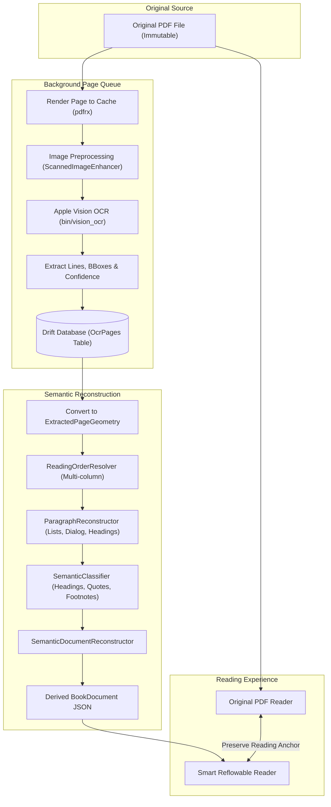

# PHASE 3.1: LOCAL-FIRST BACKGROUND OCR PIPELINE — ARCHITECTURE PLAN

> **Metadata Dokumen**
> - **Siklus / Inisiatif**: Siklus I — Core Engine & Document Pipeline (v1.0 s.d. v1.1)
> - **Modul / Kategori**: Phase 3.1 Local-First Background OCR Pipeline
> - **Urutan Dokumen**: Dokumen 02 dari 04 pada Cetak Biru Arsitektur
> - **Tanggal**: 2 November 2026
> - **Status Verifikasi**: **APPROVED**

---

Date: 2026-11-02  
Author: Senior Flutter Engineer & Software Architect  
Status: APPROVED ARCHITECTURE SPECIFICATION  

---

## 1. Executive Summary & Design Principles

The primary objective of Phase 3.1 is to turn scanned, image-only PDF pages into **structured, searchable, reflowable book content** while strictly preserving the **immutable original PDF**.

### Core Architecture Principles:
1. **Local-First & Offline**: Uses native Apple Silicon / macOS Apple Vision framework (`VNRecognizeTextRequest`) with Neural Engine acceleration. Zero cloud dependencies.
2. **Immutable Source**: The user's original PDF file is never modified or rewritten. All OCR and semantic structures are stored as derived provenance data.
3. **Page-by-Page Streaming Processing**: Pages are processed and persisted independently. The engine never loads an entire 300-page book into memory at once.
4. **Resumable & Fault-Tolerant**: Every completed page is persisted to SQLite/Drift immediately. If the application terminates or is restarted, OCR resumes from the next unfinished page without rework.
5. **Non-Blocking UI**: Background processing runs asynchronously in an isolated native process/worker. The user can read the original PDF smoothly at 60 FPS while background OCR proceeds.
6. **Unified Document Model**: Reuses existing `ExtractedPageGeometry`, `ReadingOrderResolver`, `ParagraphReconstructor`, `SemanticClassifier`, and `BookDocument`. Zero architectural divergence or competing document models.

---

## 2. Pipeline Flow Diagram



---

## 3. Database Schema Migration (Drift v3 -> v4)

A new table `OcrPages` will be added to [`lib/core/database/tables.dart`](file:///Users/davindalana/Documents/Project/Digital%20Books/lib/core/database/tables.dart) without modifying or breaking any existing tables:

```dart
class OcrPages extends Table {
  TextColumn get id => text()();
  TextColumn get bookId => text().references(Books, #id, onDelete: KeyAction.cascade)();
  IntColumn get pageIndex => integer()();
  TextColumn get status => text().withDefault(const Constant('completed'))(); // pending, completed, failed
  RealColumn get confidence => real().withDefault(const Constant(1.0))();
  IntColumn get charCount => integer().withDefault(const Constant(0))();
  RealColumn get durationMs => real().withDefault(const Constant(0.0))();
  TextColumn get linesJson => text()(); // Serialized List<OcrLineJson>
  DateTimeColumn get createdAt => dateTime()();

  @override
  Set<Column> get primaryKey => {id};
}
```

### Migration Plan (`app_database.dart`):
- `schemaVersion => 4`
- Migration rule:
  ```dart
  if (from < 4) {
    await m.createTable(ocrPages);
  }
  ```
- Guaranteed 100% backward compatibility for all existing v1, v2, and v3 user databases.

---

## 4. OCR Engine Architecture (`AppleVisionOcrService`)

- **Native Binary**: `bin/vision_ocr` compiled from `macos/tools/vision_ocr.swift`.
- **Supported Languages**: Explicitly configured for `["id-ID", "en-US"]`.
- **Level**: `VNRequestTextRecognitionLevel.accurate` with language correction.
- **Output Geometry**: Normalized coordinates $[0, 1]$ mapped to standard top-down page bounds:
  $$\text{top} = 1.0 - (y_{\text{bottom}} + \text{height})$$
- **Process Isolation**: Spawns via `Process.run` / `Process.start` with explicit cancellation token.

---

## 5. Background Queue & Lifecycle (`BackgroundOcrQueue`)

- **State Model**:
  - `status`: `idle`, `processing`, `paused`, `cancelled`, `completed`, `error`
  - `currentPage`: currently active page index
  - `completedPages`: count of finished pages
  - `totalPages`: total pages in document
  - `progress`: $0.0 \dots 1.0$
- **Interruptibility**:
  - `start(bookId, pdfPath, totalPages)`
  - `pause()`
  - `resume()`
  - `cancel()`
  - `retryFailed(bookId)`
- **Concurrency & Resource Throttling**:
  - Max 1 page worker active at a time to prevent CPU saturation.
  - Page image buffers are disposed immediately after OCR completion.
  - Periodic garbage collection between pages.

---

## 6. Layout & Semantic Reconstruction Integration

When OCR completes for all pages (or a batch of pages), the lines are converted to `ExtractedPageGeometry` and fed into:
1. [`ReadingOrderResolver`](file:///Users/davindalana/Documents/Project/Digital%20Books/lib/features/processing/services/reading_order_resolver.dart): Solves multi-column gutters and reading flow.
2. [`ParagraphReconstructor`](file:///Users/davindalana/Documents/Project/Digital%20Books/lib/features/processing/services/paragraph_reconstructor.dart): Solves hyphenated line wraps (e.g. `se-` $\to$ `buah`), indented paragraph beginnings, ordered lists (`1.`, `2.`), bullet items (`•`), and dialogues (`"..."`).
3. [`SemanticClassifier`](file:///Users/davindalana/Documents/Project/Digital%20Books/lib/features/processing/services/semantic_classifier.dart): Identifies H1, H2, H3 chapter titles, blockquotes, footnotes, and copyright metadata.
4. Outputs standard `BookDocument`, serialized to `Books.processedBookPath`.

---

## 7. Delivery Checkpoints

- **Checkpoint A**: Apple Vision OCR proof of concept on real representative pages.
- **Checkpoint B**: Drift database schema migration v4 and `OcrPages` DAO.
- **Checkpoint C**: `BackgroundOcrQueue` service with pause, resume, cancel, and state persistence.
- **Checkpoint D**: End-to-end reconstruction from OCR lines to `BookDocument`.
- **Checkpoint E**: Reader UI integration (progress indicator and switch to Reflowable).
- **Checkpoint F**: Native macOS visual validation and performance regression suite.
