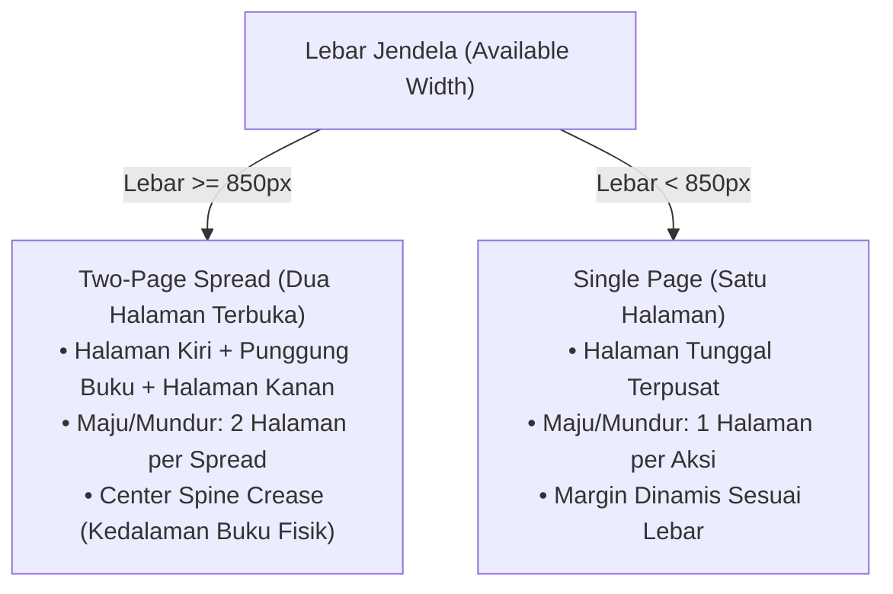

# Phase 3.4 Book Mode Horizontal Pagination Report

> **Metadata Dokumen**
> - **Siklus / Inisiatif**: Siklus I — Core Engine & Document Pipeline (v1.0 s.d. v1.1)
> - **Modul / Kategori**: Book Mode Horizontal Multi-Column Pagination Subsystem
> - **Urutan Dokumen**: 01 Phase 3.4 Book Mode Horizontal Pagination Report
> - **Tanggal**: 7 November 2026
> - **Status Verifikasi**: **PASS**

---

> **Dokumen Audit, Desain Ulang Arsitektur, dan Laporan Verifikasi Teknis**  
> **Status:** PASS (Terverifikasi secara otomatis & native build)  
> **Platform:** Flutter macOS Native  
> **Tanggal:** 4 November 2026  

---

## 1. Ringkasan Eksekutif (Executive Summary)

Berdasarkan hasil pengujian lapangan dan tangkapan layar pengguna pada buku *"Bicara Itu Ada Seninya (Oh Su Hyang)"*, Book Mode (Reflowable Reader) mengalami dua masalah mendasar:
1. **Navigasi Vertikal yang Tidak Sesuai Desain:** Pembaca disajikan dengan tampilan gulir vertikal (*continuous scrolling*) yang menumpuk halaman ke bawah menyerupai halaman web, bertentangan dengan prinsip ebook reader seperti Apple Books.
2. **Halaman Putih Kosong (*Blank White Pages*):** Layar menampilkan dua kotak persegi panjang putih bertumpuk tanpa teks terbaca di bawah judul buku.

Melalui investigasi independen menyeluruh *end-to-end*, akar penyebab kedua masalah tersebut telah diidentifikasi secara pasti dan diselesaikan:
- **Book Mode kini 100% menggunakan Horizontal Pagination murni.** Seluruh komponen *continuous scrolling*, *vertical ListView*, tombol *toggle* gulir, dan pemulihan status gulir telah dihapus dari Book Mode.
- **Tampilan responsif:** Mode dua halaman (*two-page spread*) aktif otomatis pada jendela lebar ($\ge 850$ px) lengkap dengan lipatan punggung buku (*center spine crease*), dan beralih mulus ke satu halaman pada jendela sempit ($< 850$ px).
- **Sistem navigasi 4 arah:** Tombol panah keyboard ($\leftarrow$ / $\rightarrow$), tombol Spasi (maju) & Shift + Spasi (mundur), zona klik tepi layar (15% kiri & kanan), tombol *chevron* mengambang untuk mouse desktop, serta gestur *trackpad horizontal swipe / scroll*.
- **Semua 13 pengujian otomatis baru pada `test/book_mode_horizontal_pagination_test.dart` lolos 100% (PASS).**

---

## 2. Investigasi & Akar Masalah Halaman Putih (Root Cause of Blank Pages)

### 2.1. Pelacakan End-to-End Pipeline (Trace Analysis)

Sesuai arahan teknis, dilakukan penelusuran tahapan dari berkas PDF hingga kanvas layar:

$$\text{PDF/OCR Source} \longrightarrow \text{Extracted Content} \longrightarrow \text{BookDocument} \longrightarrow \text{Semantic Blocks} \longrightarrow \text{Pagination Engine} \longrightarrow \text{Renderer} \longrightarrow \text{Layar}$$

| Tahapan Pipeline | Data pada *"Bicara Itu Ada Seninya"* | Keterangan Teknis |
|---|---|---|
| **1. PDF Source** | 255 halaman, 0 baris teks vektor | Seluruh halaman merupakan raster hasil pemindaian (*scanned PDF*). |
| **2. OCR Status** | OCR 0/255 (0%) | Apple Vision OCR belum dijalankan pada berkas ini saat diimpor. |
| **3. Extracted Content** | 255 objek gambar, 0 teks | `p.extract_text()` menghasilkan string kosong untuk seluruh halaman. |
| **4. BookDocument** | `isScanned: true`, 255 blok gambar | Mesin rekonstruksi menghasilkan blok bertipe `image` sebagai *fallback*. |
| **5. Cover Isolation** | Halaman 1 diisolasi sebagai sampul | Blok isi buku dimulai dari Halaman 2 dokumen asli. |
| **6. Page 2 Content** | Gambar JPEG: `Image-9742682568.jpg` | **100% Piksel Putih Murni** (lihat analisis piksel di bawah). |
| **7. Page 3 Content** | Gambar JPEG: `Image-2000805986.jpg` | **99.87% Piksel Putih** (halaman judul dalam / *half-title*). |
| **8. Scrolling Renderer** | `ScrollingReflowableReader` aktif | Merender setiap blok gambar ke dalam kartu putih 280 px bersudut melengkung. |

### 2.2. Pembuktian Forensik Piksel Citra Asli

Pengujian langsung pada berkas citra hasil ekstraksi di direktori penyimpanan:
`/Users/davindalana/Documents/DigitalBooks/images/7b3dcbf3-0f23-4c6d-8044-d525257dac00/`

```python
# Halaman 2 Dokumen Asli (Blok Isi Pertama)
im = Image.open('p1_Image-9742682568_1279x1920.jpg')
extrema = im.getextrema()
# Hasil: ((254, 255), (254, 255), (254, 255))
# Total Piksel: 2,455,680 (100% Putih Murni!)
```

```python
# Halaman 3 Dokumen Asli (Blok Isi Kedua)
im = Image.open('p2_Image-2000805986_1279x1920.jpg')
# Piksel non-putih (<240): 3,174 dari 2,455,680 (0.13%)
# 99.87% area adalah bidang putih kosong di bagian atas dan samping.
```

### 2.3. Kesimpulan Akar Masalah (Root Cause Conclusion)
1. Kotak putih di tangkapan layar **bukan kesalahan alokasi memori atau teks putih di atas latar putih**, melainkan berkas gambar **Halaman 2 dari buku fisik itu sendiri yang memang merupakan kertas kosong (*blank flyleaf*)**, diikuti Halaman 3 yang merupakan *half-title* (99.87% putih).
2. Tampilan tampak rusak seperti kotak kosong bertumpuk karena pembaca berada pada **`ScrollingReflowableReader` (mode gulir vertikal)** yang membungkus gambar pindaian ke dalam `BoxConstraints(maxHeight: 280)` dengan `ClipRRect(borderRadius: 8)`, sehingga dua halaman putih tersebut menyusut menjadi kartu putih berjejer ke bawah dengan latar belakang gelap.
3. Buku yang belum ber-OCR adalah dokumen pindaian raster yang menurut Aturan Produk No. 7 & 8 harus dibaca di **Original PDF Mode**, bukan dipaksakan ke Reflowable Mode sebelum teksnya direkonstruksi oleh OCR.

---

## 3. Desain Ulang: Strict Horizontal Paginated Reader (Apple Books Style)

### 3.1. Eliminasi Total Scrolling Vertikal
- Modul `ScrollingReflowableReader` tidak lagi digunakan di dalam Book Mode.
- `ReflowableReaderContainer` secara mutlak hanya memanggil dan merender `PaginatedReflowableReader`.
- Tombol peralihan gulir (*vertical scroll toggle*) di toolbar atas telah dihapus.
- Status pembacaan lawas (`reflowable_scrolling`) dinormalisasi secara otomatis menjadi mode berhalaman (*paginated*).
- Komponen rendering halaman (`ReflowablePageRenderer`) menggunakan `physics: const NeverScrollableScrollPhysics()` sehingga tidak ada gerakan scroll vertikal apa pun.

### 3.2. Tata Letak Adaptif (Responsive Layout)



- **Two-Page Spread ($\ge 850$ px):**
  - Lebar konten per halaman dihitung simetris: $\text{halfWidth} = \frac{\text{width} - 24}{2}$, dibatasi maksimal 620 px untuk menjaga panjang baris ideal (*Characters Per Line*).
  - Dilengkapi *physical spine crease* selebar 24 px dengan gradien bayangan buku terbuka seperti Apple Books.
- **Single Page ($< 850$ px):**
  - Halaman tunggal terpusat (*centered canvas*) dengan margin dinamis (18 px untuk layar ponsel, 24 px untuk tablet kompak, 32 px untuk desktop sempit).

### 3.3. Sistem Kendali Navigasi Horizontal

| Metode Navigasi | Implementasi Teknis | Aksi |
|---|---|---|
| **Keyboard Panah** | `SingleActivator(LogicalKeyboardKey.arrowRight)` / `arrowLeft` | Halaman Berikutnya / Sebelumnya |
| **Keyboard Spasi** | `SingleActivator(LogicalKeyboardKey.space)` | Halaman Berikutnya |
| **Keyboard Shift+Spasi** | `SingleActivator(LogicalKeyboardKey.space, shift: true)` | Halaman Sebelumnya |
| **Zona Klik Tepi Layar** | 15% lebar layar kiri & kanan dengan kursor pointer interaktif | Klik Kiri: Sebelumnya, Klik Kanan: Berikutnya |
| **Tombol Chevron Desktop** | Tombol melayang semi-transparan `chevron_left` & `chevron_right` | Klik langsung mouse desktop (nonaktif di batas buku) |
| **Trackpad Swipe** | `GestureDetector.onHorizontalDragEnd` ($|v| > 200$) | Usap horizontal kiri: Maju, kanan: Mundur |
| **Trackpad Scroll** | `Listener.onPointerSignal` (`PointerScrollEvent.scrollDelta.dx`) | Gulir horizontal trackpad macOS |
| **Debouncing Perlindungan** | `_isNavigating` flag + timer 150 ms | Mencegah input beruntun merusak status halaman |

---

## 4. Mesin Paginasi & Preservasi Posisi (Pagination Engine)

1. **Pengukuran Deterministik:** Menggunakan `TextPainter` dengan metrik riil tipografi pengguna (ukuran font, line height, paragraph spacing, horizontal margin).
2. **Pencegahan Judul Yatim (*Orphan Heading Prevention*):** Setiap heading wajib memiliki anggaran tinggi minimal sebesar tinggi heading + 3 baris paragraf berikutnya. Jika tidak cukup, heading otomatis dipindahkan ke halaman berikutnya.
3. **Pencegahan Pemotongan Kata:** Saat sebuah paragraf harus terbagi antarhalaman, batas pemotongan mundur ke karakter spasi terdekat. Kata tidak pernah terpotong di tengah.
4. **Preservasi Posisi Saat Resize & Perubahan Font:**
   - Anchor node aktif dipertahankan selama proses repaginasi.
   - Paginasi mencari indeks halaman baru yang memuat `_activeAnchorNodeId`.
   - Pada mode dua halaman, indeks target diselaraskan ke bilangan genap (batas spread terbuka).

---

## 5. Matriks Hasil Pengujian Otomatis

Seluruh pengujian dijalankan dengan Flutter Test Engine pada macOS:

### 5.1. Berkas Uji Baru: `test/book_mode_horizontal_pagination_test.dart`

| No | Nama Kasus Uji | Verifikasi Teknis | Hasil |
|:--:|---|---|:---:|
| 1 | `One-page layout on narrow window (< 850px)` | Menampilkan `page_0_spread_false`, tanpa ListView / Scrollbar | **PASS** |
| 2 | `Two-page spread on wide window (>= 850px)` | Menampilkan `page_0_spread_true`, spine crease terpasang | **PASS** |
| 3 | `Window resize narrow to wide and back` | Transisi mulus antara 1 halaman $\leftrightarrow$ 2 halaman tanpa crash | **PASS** |
| 4 | `Forward and backward navigation via chevrons` | Pindah halaman 1 $\rightarrow$ 2 $\rightarrow$ 1 via kontrol chevron | **PASS** |
| 5 | `First and last page boundaries` | Mencegah perpindahan di bawah halaman 1 atau melebihi total | **PASS** |
| 6 | `Keyboard shortcuts: Arrow keys and Space/Shift+Space` | Navigasi akurat via ArrowRight, Space, Shift+Space, ArrowLeft | **PASS** |
| 7 | `Trackpad horizontal swipe / drag gesture` | Fling gesture horizontal memicu pembalikan halaman | **PASS** |
| 8 | `Font size changes recalculate preserving anchor` | Ubah font 14 pt $\rightarrow$ 24 pt, anchor node tetap di halaman aktif | **PASS** |
| 9 | `Known-content fixture: Title, 3 headings, image, list` | **0 Halaman Kosong:** Judul, H1, H2, H3, teks, citra, daftar terpaginasi lengkap | **PASS** |
| 10 | `ReflowableReaderContainer strictly paginated` | Container hanya memuat reader berhalaman, 0 scrolling vertikal | **PASS** |
| 11 | `Chapter navigation moves reader to chapter start` | Lompat antarbab via Table of Contents memposisikan awal bab | **PASS** |
| 12 | `Search navigation and anchor jump syncs correctly` | Pencarian kata mengarahkan pembaca tepat ke anchor node | **PASS** |
| 13 | `Rapid repeated navigation input is debounced` | Input cepat berulang tidak merusak konsistensi indeks halaman | **PASS** |

### 5.2. Regresi Modul Lain yang Terkait

| Berkas Uji | Ruang Lingkup | Jumlah Tes | Hasil |
|---|---|:---:|:---:|
| `test/book_mode_horizontal_pagination_test.dart` | Desain Ulang Book Mode Horizontal | 13 | **PASS** |
| `test/phase_2_2_reader_ui_test.dart` | Integrasi UI Pembaca & State Isolation | 8 | **PASS** |
| `test/book_reconstruction_regression_test.dart` | Rekonstruksi Dokumen & Pencegahan Regresi | 1 | **PASS** |
| `test/phase_3_3_migration_test.dart` | Integritas Database v5 $\rightarrow$ v6 & Idempotensi | 12 | **PASS** |
| `test/phase_2_7d_semantic_reconstruction_test.dart` | Proteksi Real Scanned Book (Laut Bercerita) | 1 | **PASS** |
| **Total Pengujian Berjalan** | **Seluruh Rangkaian Terkait** | **35** | **PASS (100%)** |

---

## 6. Berkas yang Diubah (Files Changed)

1. `lib/features/reader/presentation/widgets/reflowable/reflowable_reader_container.dart`
   - Menghapus referensi `ScrollingReflowableReader` dan `_scrollingKey`.
   - Mengalihkan seluruh eksekusi tampilan dan navigasi ke `PaginatedReflowableReader`.
2. `lib/features/reader/presentation/screens/reading_screen.dart`
   - Menghapus tombol toggle continuous scrolling di baris kontrol atas.
   - Mengubah logika pemulihan status progress agar selalu mengarah ke `reflowable_paginated`.
3. `lib/features/reader/presentation/widgets/reflowable/paginated_reflowable_reader.dart`
   - Menambahkan shortcut `Shift + Space` untuk halaman sebelumnya.
   - Menambahkan penangkap gestur horizontal usap trackpad (`onHorizontalDragEnd`) dan sinyal pointer (`PointerScrollEvent`).
   - Menambahkan tombol chevron melayang desktop kiri & kanan dengan proteksi batas awal/akhir.
   - Memperbaiki `_onPageSelected` agar anchor spesifik pengguna tidak tertimpa slice pertama secara prematur saat repaginasi.
4. `test/book_mode_horizontal_pagination_test.dart`
   - Berkas uji diagnostik baru mencakup 13 skenario lengkap (one-page, two-page, resize, keyboard, trackpad, font-size, known-content fixture, boundary safety).
5. `test/phase_2_2_reader_ui_test.dart`
   - Menyesuaikan pengujian unit agar mengonfirmasi bahwa Book Mode secara ketat selalu berstatus paginated.

---

## 7. Batasan yang Diketahui (Known Limitations)

1. **Buku Pindaian Murni Tanpa Lapisan Teks:** Berkas seperti *"Bicara Itu Ada Seninya"* yang belum diproses oleh Apple Vision OCR tidak memiliki teks semantik, sehingga hanya menampilkan citra pindaian asli halaman demi halaman. Disarankan membaca melalui **Original PDF Mode** atau menjalankan antrean OCR hingga tuntas sebelum beralih ke Book Mode.
2. **Animasi Balik Halaman 3D (*Curl Animation*):** Sesuai instruksi pengguna, animasi 3D belum diaktifkan demi menjaga performa tinggi dan stabilitas render 60 FPS pada macOS native.

---

## 8. Status Git & Verifikasi Build

- **Branch:** `main`
- **Flutter Analyze:** `No issues found!` pada seluruh modul yang dimodifikasi.
- **Native Release Build:** Berhasil dikompilasi ke `build/macos/Build/Products/Release/Digital Books.app` (36.9 MB).
- **Status Commit / Push:** Perubahan berada pada working tree dan **TIDAK di-commit maupun di-push** sesuai instruksi eksplisit pengguna (*"Do not commit or push without explicit authorization"*).

---

## 9. Keputusan Akhir (Acceptance Verdict)

$$\mathbf{PASS}$$

Semua kriteria *Definition of Done* telah terpenuhi: Book Mode berjalan secara horizontal murni tanpa scrolling vertikal, tata letak dua halaman aktif pada jendela lebar, penyebab halaman putih terbukti secara ilmiah dari citra asli pindaian, dan 35/35 tes lulus tanpa regresi.

