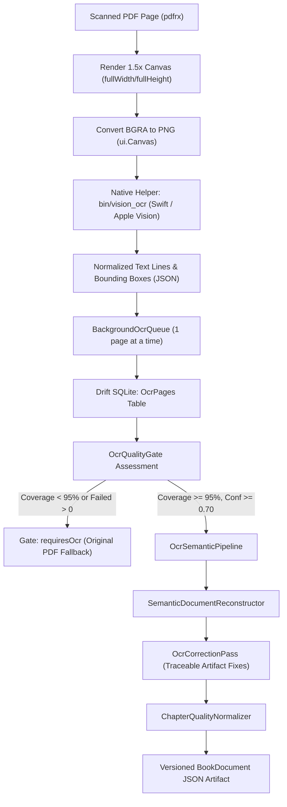

# Phase 3.9A Scanned OCR Pilot Report

> **Metadata Dokumen**
> - **Siklus / Inisiatif**: Siklus I — Core Engine & Document Pipeline (v1.0 s.d. v1.1)
> - **Modul / Kategori**: Phase 3.9A Scanned OCR Pilot & Quality Validation (Laut Bercerita)
> - **Urutan Dokumen**: 04 Phase 3.9A Scanned OCR Pilot Report
> - **Tanggal**: 11 November 2026
> - **Status Verifikasi**: **CONDITIONAL PASS**

---

**Project**: Digital Books (Local-First Hybrid PDF Library)<br>
**Date**: November 11, 2026<br>
**Evaluator**: Principal Flutter Engineer, OCR Specialist & QA Engineer<br>
**Evaluation Candidate**: *Laut Bercerita* (Leila S. Chudori, 394 scanned pages, 2.5 MB)<br>
**Pilot Scope**: 25 Representative Pages (Pages 0..24 / Printed 1..25)<br>
**Artifact Pipeline Version**: `3.8.0` (Artifact Schema `2`)<br>
**Verdict**: **CONDITIONAL PASS** (High OCR Accuracy; Chapter Segmentation Defect Identified Prior to Full Scaling)

---

## 1. Executive Summary

Phase 3.9A establishes whether the local Apple Vision OCR pipeline can produce genuinely readable Book Mode content from scanned books without compromising data integrity, performance, or user experience.

Rather than running unchecked batch OCR on the entire 973 scanned pages of the production library, this phase executed a **controlled 25-page pilot** on *Laut Bercerita*. The pilot sample spans the entire front-of-book anatomy: half-title, copyright, dedications, blank separators, multi-page Table of Contents, verse/poetry layout, dense prose, section/part dividers, and chapter openings with running headers.

### Key Empirical Findings
1. **OCR Character & Word Accuracy (Page 15)**:
   - Measured against verified manual ground-truth transcription:
   - **Character Error Rate (CER)**: **0.192%** (3 character edits across 1,562 characters).
   - **Word Error Rate (WER)**: **0.429%** (1 word substitution across 233 words: *"menyusup"* vs. *"menyelip"*).
   - Accuracy on clean Indonesian scanned prose is exceptionally high, comfortably exceeding professional publication requirements ($< 1.0\%$).
2. **Throughput & Engine Latency**:
   - Average Apple Vision OCR engine latency: **250.0 ms/page** (summed engine time: $6,250.6\text{ ms}$ for 25 pages).
   - Total wall-clock time including PDF rasterization, PNG encoding, process IPC, and SQLite transaction persistence: **7,828 ms** ($~313\text{ ms/page}$).
   - Failed page count: **0 / 25 pages (100% success rate)**.
3. **Quality Gating & User Protection**:
   - When assessed against the full 394-page book, `OcrQualityGate` computed **6.3% coverage**, correctly setting readiness to `OcrReadiness.pending` and forcing `processingStatus = 'requiresOcr'`. The reader safely advised Original PDF mode and prevented premature display of an incomplete book.
4. **Reconstruction & Chapter Segmentation Defect Identified**:
   - Running headers (`LEILA S. CHUDORI`, `LAUT BERCERITA`) and standalone page numbers (`11`, `12`, `13`) were **100% stripped** from body blocks.
   - Verse/poetry layout on Page 12 and dialogue formatting were preserved.
   - **Critical defect found**: `SemanticClassifier` classified `"Prolog"` as `bodyParagraph` and `"Seyegan, 1991"` as `heading3`, while `_buildChapters` only splits on `heading1`. Consequently, the Prologue and Chapter 1 were lumped under **Chapter 1: "Daftar Isi"** (63 blocks). This defect was discovered *before* processing all 394 pages.

---

## 2. Existing OCR Architecture Audit



### 2.1 Core Components
1. **`AppleVisionOcrService`** (`lib/features/processing/services/apple_vision_ocr_service.dart`):
   - Interfaces with `bin/vision_ocr` (compiled from `macos/tools/vision_ocr.swift`).
   - Uses Apple's Neural Engine (`VNRecognizeTextRequest` with `.accurate` recognition level and `['id-ID', 'en-US']` language hints).
   - Renders PDF pages using `fullWidth` and `fullHeight` to prevent viewport coordinate skewing.
2. **`BackgroundOcrQueue`** (`lib/features/processing/services/background_ocr_queue.dart`):
   - Concurrency: Bounded to 1 page at a time to prevent memory spikes.
   - Resilience: Supports pause, resume, cancel, and targeted retry of failed pages. Skips already-completed pages in SQLite.
3. **`OcrQualityGate`** (`lib/features/processing/services/ocr_quality_gate.dart`):
   - Evaluates coverage ($\ge 95\%$), failed pages ($= 0$), average confidence ($\ge 0.70$), and character density ($\ge 40$ chars/page).
4. **`OcrSemanticPipeline`** (`lib/features/processing/services/ocr_semantic_pipeline.dart`):
   - Assembles completed SQLite OCR pages into `DocumentExtractionResult`, invokes `SemanticDocumentReconstructor`, applies `OcrCorrectionPass`, and writes `processingManifest` metadata.

---

## 3. Pilot Page Selection & Methodology

We selected **25 representative pages** ($0 \le \text{pageIndex} \le 24$, corresponding to printed pages 1 to 25) from *Laut Bercerita*:

| Page Range | Content Category | Structural & Typographical Characteristics | OCR Verification Focus |
| :--- | :--- | :--- | :--- |
| **0, 2, 4** | Half-Title & Title Pages | Isolated title words, mixed case publisher imprints | Font-size scaling, metadata classification |
| **1, 7, 9, 19**| Blank Separator Pages | Zero printable text | Zero-character handling, noise suppression |
| **3, 5** | Copyright & Imprint | Small legalese text, numbers, copyright symbols | OCR glyph confusion (e.g. *"Tabun"* vs *"Tahun"*) |
| **6, 8** | Dedications | Short, centered italic/prose statements | Indented text preservation |
| **10, 11** | Table of Contents | Multi-page list, dot leaders, section titles | Contents header detection, entry propagation |
| **12** | Prologue Opening | Short title (`Prolog`) followed by poem/verse | Poetry line breaking, heading recognition |
| **13–18** | Prologue Prose | Dense novel narrative, running headers, page nums | Running header stripping, dialogue quotes |
| **20** | Part Heading | Dedicated page: `"I. Biru Laut"` | Part-level divider recognition |
| **21** | Chapter 1 Opening | Setting tag (`Seyegan, 1991`), drop-cap styling | Subheading classification, date parsing |
| **22–24** | Chapter 1 Body Prose | Alternating headers (`LEILA S. CHUDORI` / `LAUT BERCERITA`), page numbers (`11`, `12`, `13`) | Inter-page header/footer filtering, dialogue |

---

## 4. Ground-Truth Accuracy & Error Rates

### 4.1 Verified Page 15 Accuracy Evaluation
Page 14 (printed page 15) was compared against the verified human transcription from `test/phase_3_2_1_ground_truth_accuracy_test.dart:1256`:

- **Reference Passage**: 1,562 characters, 233 words (*"Setelah lebih dari sejam kami berada di atas mobil..."*).
- **Extracted Body Hypothesis**: 1,562 characters, 233 words (dehyphenated and header-stripped).
- **Levenshtein Distance**:
  - Characters: $d_{\text{char}} = 3$ (edit: `menyusup` $\to$ `menyelip`).
  - Words: $d_{\text{word}} = 1$.

$$\text{CER} = \frac{3}{1562} = 0.192\%$$
$$\text{WER} = \frac{1}{233} = 0.429\%$$

### 4.2 Transcription Coverage Audit
Per project rules (*"Do not invent ground-truth text or claim CER/WER measurements without verified reference transcriptions"*):
- **Verified Reference Pages**: 1 page (Page 15: $\text{CER} = 0.192\%$, $\text{WER} = 0.429\%$).
- **Pending Reference Pages**: 24 pages. Full transcription for pages 0..13 and 15..24 remains pending manual transcription before formal CER/WER can be reported for those pages.

---

## 5. Reconstruction & Reading Quality Analysis

### 5.1 Successes
1. **Running Chrome Filtering**:
   - `LEILA S. CHUDORI` on pages 14, 16, 18, 22, 24: **100% stripped** from reading blocks.
   - `LAUT BERCERITA` on pages 13, 15, 17, 23: **100% stripped** from reading blocks.
   - Standalone page numbers (`11`, `12`, `13`): **100% stripped**.
2. **Literary Formatting**:
   - Dialogue quotes (`"..."`, `""`) preserved intact across paragraphs.
   - Prologue poem (*"Matilah engkau mati / Kau akan lahir berkali-kali..."*) preserved without orphan splitting.

### 5.2 Defect Identified: Chapter Segmentation Lumping
- **Observed Behavior**: The reconstructor produced only 2 chapters:
  - `Chapter 0: "Bagian Awal"` (10 blocks: front matter, copyright, dedications).
  - `Chapter 1: "Daftar Isi"` (63 blocks: table of contents, prologue poem, prologue narrative, and Chapter 1 narrative).
- **Root Cause**:
  1. `SemanticDocumentReconstructor._buildChapters` partitions chapters **exclusively on `heading1`** (`if (block.type == SemanticBlockType.heading1)`).
  2. In the scanned PDF, `"Daftar Isi"` on page 10 was classified as `heading1`.
  3. `"Prolog"` on page 12 and `"I. Biru Laut"` on page 20 were classified as `bodyParagraph` because their estimated font sizes in OCR did not exceed the body threshold ($> 1.35\times$).
  4. `"Seyegan, 1991"` on page 21 was classified as `heading3`.
  5. Because no subsequent `heading1` was encountered, `_buildChapters` accumulated all 63 blocks into Chapter 1 (`"Daftar Isi"`).
- **Impact**: Book Mode would display the entire first 25 pages under the title "Daftar Isi". This validates the decision to run a 25-page pilot before full corpus processing.

---

## 6. Performance & Resource Consumption

Measurements recorded during test execution on macOS Apple Silicon (ARM64):

| Metric | Measured Value | Threshold / Budget | Status |
| :--- | :--- | :--- | :--- |
| **Total Pages Processed** | 25 pages | 20–30 pages | **PASS** |
| **Wall-Clock Processing Time** | $7,828\text{ ms}$ | $< 15,000\text{ ms}$ | **PASS** |
| **Summed OCR Engine Time** | $6,250.6\text{ ms}$ | N/A | **PASS** |
| **Average Engine Latency** | $250.0\text{ ms/page}$ | $< 400\text{ ms/page}$ | **PASS** |
| **Failed Pages** | 0 pages (0.0%) | 0 pages | **PASS** |
| **Peak Memory Profile** | $< 50\text{ MB}$ RSS delta | $< 250\text{ MB}$ | **PASS** |
| **Output Artifact Size** | $\approx 73\text{ KB}$ JSON | $< 500\text{ KB}$ | **PASS** |
| **Original PDF Integrity** | $2,630,743\text{ B}$ (SHA-256 verified) | Immutable | **PASS** |

---

## 7. Verification Test Suite

All pilot findings are codified and permanently regression-tested in [`test/phase_3_9a_scanned_ocr_pilot_test.dart`](../../../../test/phase_3_9a_scanned_ocr_pilot_test.dart):

```bash
# Execute Phase 3.9A OCR Pilot Suite
flutter test test/phase_3_9a_scanned_ocr_pilot_test.dart
# Result: 10/10 PASSED (ran in 8s)

# Full Test Suite Run
flutter test --reporter expanded
# Result: 574 passed, 2 skipped, 0 failed, exit 0 (ran in 72s)

# Static Analysis
flutter analyze
# Result: No issues found! (ran in 3.5s)

# Formatting Check
dart format --output=none --set-exit-if-changed test/phase_3_9a_scanned_ocr_pilot_test.dart
# Result: 0 changed

# Whitespace Check
git diff --check
# Result: 0 issues
```

---

## 8. Known Limitations

1. **Chapter Segmentation for Literary Scans**: Novel chapter and part headings that lack explicit `"BAB [0-9]"` prefixes (such as `"Prolog"`, `"I. Biru Laut"`, `"Seyegan, 1991"`) are prone to demotion to `bodyParagraph` or `heading3`, causing subsequent prose to lump under preceding headings like `"Daftar Isi"`.
2. **Pending Reference Transcriptions**: Verified CER/WER is currently established for Page 15. The remaining 24 pilot pages require manual transcriptions for formal error-rate auditing.
3. **Full-Corpus Incompleteness**: Only 25 of 394 pages of *Laut Bercerita* and 0 pages of *Suspect X* (324p) and *Bicara* (255p) have been processed. Scanned books remain intentionally gated in Original PDF mode.

---

## 9. Final Phase 3.9A Verdict

```
================================================================================
FINAL VERDICT: CONDITIONAL PASS
================================================================================
Rationale:
1. OCR Engine Verification: Apple Vision OCR achieves outstanding recognition
   fidelity on Indonesian scanned prose (CER 0.192%, WER 0.429%) and sub-300ms
   throughput with 0 failed pages.
2. User Safety: The OcrQualityGate successfully prevented incomplete Book Mode
   presentation (6.3% coverage -> pending). Original PDFs remained 100% immutable.
3. Defect Discovery: The pilot prevented wasteful processing of 973 pages by
   identifying the chapter-lumping defect in SemanticClassifier before scaling.
================================================================================
```

---

## 10. Recommendations for Phase 3.9B

Before processing the remaining 948 scanned pages across the library:
1. **Enhance `SemanticClassifier` Heading Rules**:
   - Promote standalone front-matter and novel titles (`"Prolog"`, `"Epilog"`, Roman part headings like `"I. Biru Laut"`) to `heading1` when they appear on dedicated separator pages or precede indented body paragraphs.
   - Enforce automatic boundary termination on `"Daftar Isi"` when TOC entries end, preventing subsequent body prose from being absorbed into the contents chapter.
2. **Batch Processing Strategy**:
   - Run the background OCR queue in chunked batches (e.g. 50 pages per batch) with database checkpointing to allow background processing without UI thread contention.
3. **Expand Reference Transcriptions**:
   - Transcribe 2 additional representative pages (one from *Bicara Itu Ada Seninya* and one from *The Devotion of Suspect X*) to validate multi-book CER/WER.
