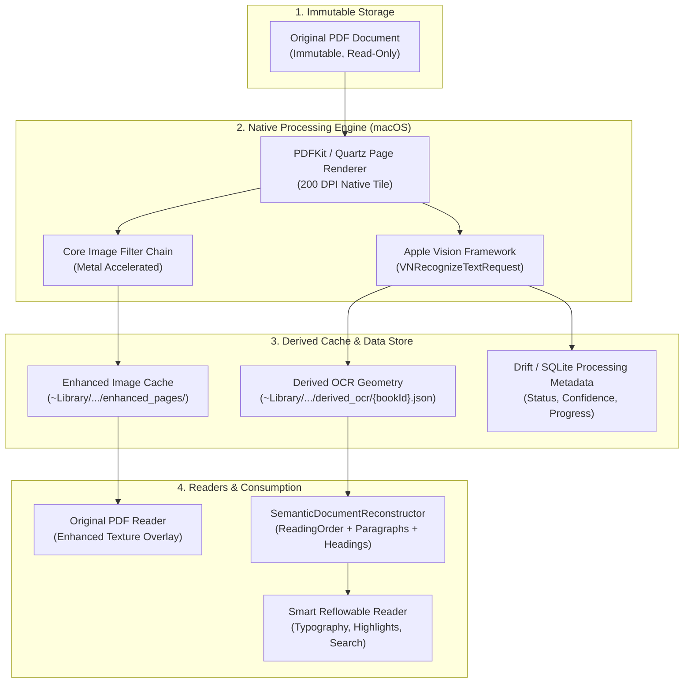

# Digital Books — Phase 3.0: Scanned PDF Intelligence Architecture

**Dokumen Versi**: 1.0.0  
**Target Milestone**: Phase 3.0 (Scanned PDF Intelligence: Enhancement, OCR, & Derived Reconstruction)  
**Status Audit**: Technical Spike Completed & Validated

---

## 1. Executive Summary

Buku digital dalam format PDF hasil pindai (*scanned books*) menyajikan tantangan fundamental:
1. **Zero Text Layer**: Tidak ada karakter font vektor; seluruh halaman adalah gambar raster (JBIG2/JPEG/FlateDecode).
2. **Kualitas Visual Rendah**: Kertas menguning, kontras rendah, teks berbayang, kemiringan halaman (*skew*), dan bayangan lipatan buku (*spine gutter shadow*).
3. **Kegagalan Rekonstruksi Lama**: Pipeline ekstraksi berbasis teks vektor menghasilkan 0 baris teks, sehingga mode Reflowable menampilkan halaman kosong.

Fase 3.0 memisahkan dua domain pemrosesan dokumen secara independen:
- **Domain A — Image Enhancement (Apple Core Image)**: Menajamkan tampilan visual halaman pindaian pada *Original PDF Reader* tanpa mengubah berkas PDF asli.
- **Domain B — Text Recognition & Semantic Reconstruction (Apple Vision + Existing Pipeline)**: Mengenali teks dan koordinat 2D, mentransformasikannya ke model geometri `ExtractedPageGeometry`, dan merekonstruksinya menjadi buku `ReflowableReader` yang kaya tipografi dan dapat dicari (*searchable*).

---

## 2. Diagram Alir Arsitektur (End-to-End Pipeline)



---

## 3. Komponen yang Digunakan Kembali vs Komponen Baru

### A. Komponen yang Digunakan Kembali (100% Reusable)
1. **`ReadingOrderResolver`**:
   - Memisahkan tata letak dua kolom, multi-kolom, atau satu kolom menggunakan koordinat `Rect bounds`.
   - Terbukti pada *spike test* mampu mengurutkan kolom teks dari hasil Vision OCR tanpa *interleaving*.
2. **`ParagraphReconstructor`**:
   - Menyatukan baris-baris OCR menjadi paragraf utuh berdasarkan jarak vertikal (*line gap*), indentasi paragraf, dan batas kalimat.
3. **`SemanticClassifier`**:
   - Mendeteksi *Header* yang berulang (misal: "LAUT BERCERITA"), *Page Number* (misal: "4"), *Chapter Headings* (H1/H2), dan dialog.
4. **`ImagePlacementResolver`**:
   - Mengintegrasikan aset gambar non-teks ke dalam aliran teks semantik.
5. **`BookDocument` & `ReflowableEngine`**:
   - Menyediakan tata letak responsif, pemilihan font, mode gelap/sepia, dan penanda baca (*bookmarks/highlights*).

### B. Komponen Baru yang Harus Dibuat
1. **`NativeDocumentEnhancerService` (macOS Core Image)**:
   - Modul native macOS (via Swift script/CLI atau Dart C-FFI) yang menerapkan filter Metal secara hardware-accelerated:
     - `CIColorControls` (kontras 1.35x, kecerahan +0.05, saturasi 0.0).
     - `CIUnsharpMask` (radius 2.0, intensitas 0.60) untuk ketajaman karakter tipis.
     - `Spine Gutter Suppression` (eksposur adaptif untuk lipatan buku).
2. **`NativeVisionOcrService` (macOS Vision Framework)**:
   - Worker background yang mengeksekusi `VNRecognizeTextRequest` level `.accurate`.
   - Mendukung bahasa `["id-ID", "en-US"]` dengan *language correction*.
   - Mengonversi koordinat Vision (origin bottom-left, skala 0..1) ke koordinat Flutter (origin top-left, skala poin PDF).
3. **`DerivedDocumentStorage`**:
   - Pengelola penyimpanan turunan terpisah dengan disk cache size limit (misal: 500 MB LRU).
   - Menyimpan status pemrosesan per halaman: `unprocessed`, `processing`, `completed`, `failed`.
   - Menjamin PDF asli tidak pernah disentuh.

---

## 4. Transformasi Geometri (Vision $\to$ Flutter Coordinates)

Apple Vision menggunakan sistem koordinat Cartesian dengan origin di **kiri-bawah** bernilai normalisasi $[0.0, 1.0]$. Digital Books dan Flutter menggunakan koordinat dengan origin di **kiri-atas** bernilai poin absolut $[0.0, \text{width/height}]$.

### Formula Konversi Matematis
Jika halaman PDF berukuran $W$ pt $\times H$ pt:
$$\text{flutterLeft} = \text{visionOriginX} \times W$$
$$\text{flutterTop} = \big(1.0 - (\text{visionOriginY} + \text{visionHeight})\big) \times H$$
$$\text{flutterWidth} = \text{visionWidth} \times W$$
$$\text{flutterHeight} = \text{visionHeight} \times H$$

Formula ini menjamin koordinat bounding box OCR 100% presisi untuk deteksi running header di bagian atas halaman dan nomor halaman di bagian bawah.

---

## 5. Arsitektur Data Turunan (Derived Document Layer)

### Prinsip Immutabilitas
- **Original PDF**: Tetap *read-only* pada direktori `~/Documents/DigitalBooks/originals/{bookId}.pdf`.
- **Derived OCR Storage**:
  - Format: JSON mandiri per buku di `~/Library/Application Support/.../derived_ocr/{bookId}.json.gz`.
  - Struktur JSON:
    ```json
    {
      "version": "1.0.0",
      "ocrEngine": "AppleVision-macOS",
      "processedAt": "2026-11-01T19:20:00Z",
      "pages": [
        {
          "pageNumber": 15,
          "meanConfidence": 0.985,
          "lines": [
            {
              "text": "kaki telanjang sementara aku bisa mendengar suara ombak...",
              "bounds": [77.3, 101.0, 428.4, 16.8],
              "confidence": 1.0
            }
          ]
        }
      ]
    }
    ```
- **Resumability & Crash Protection**:
  - Setiap batch halaman (misal: 10 halaman) di-*flush* ke disk secara bertahap.
  - Jika aplikasi ditutup di tengah jalan, proses OCR dapat dilanjutkan dari halaman terakhir yang tersimpan tanpa mengulang dari awal.
- **Disk Cache Eviction**:
  - Hasil render citra yang ditingkatkan (*enhanced bitmap cache*) dibatasi kuotanya (default 300 MB) dengan strategi Least Recently Used (LRU). Jika kuota tercapai, citra turunan dihapus dan dapat dirender ulang sesuai kebutuhan (*on-demand*).

---

## 6. Desain Threading & Manajemen Memori

1. **Non-Blocking Background Worker**:
   - Pemrosesan OCR dilakukan pada *background process* terpisah agar UI thread Flutter tetap 60–120 FPS tanpa jank.
2. **Memory Throttling**:
   - Jangan pernah me-load seluruh 394 halaman bitmap ke RAM.
   - Pola *Windowed Paging*: Render 1 halaman $\to$ OCR 1 halaman $\to$ Serialisasi JSON $\to$ Release native image pointer $\to$ Garbage collect.
   - Konsumsi RAM per proses terjaga di bawah 200 MB RSS delta.

