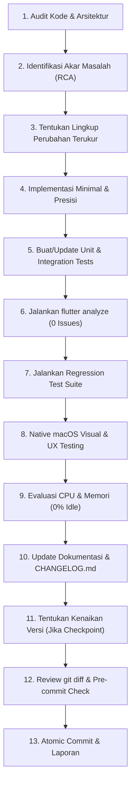

# Digital Books — Development Workflow & Engineering Governance

Panduan ini mengatur standar baku pengembangan, tata kelola Git, pengujian kualitas, pencatatan changelog, dan mitigasi risiko regresi untuk seluruh fase proyek **Digital Books**.

---

## 1. Siklus Pengembangan Baku (Development Cycle)

Setiap tugas atau fase fitur wajib melalui 13 langkah berurutan:



---

## 2. Standar Commit (Conventional Commits)

Digital Books menerapkan **Conventional Commits** secara ketat. Satu commit mewakili satu perubahan logis (atomic commit).

### Tipe Commit

- `feat:` Penambahan kemampuan atau fitur baru bagi pengguna (misal: mode membaca baru, pipeline ekstraksi).
- `fix:` Perbaikan bug atau perilaku abnormal (misal: eliminasi blank flash, perbaikan text slicing).
- `perf:` Optimasi performa, latensi render, memori bitmap, atau alokasi CPU.
- `refactor:` Restrukturisasi kode tanpa mengubah perilaku eksternal atau menambah fitur.
- `test:` Penambahan atau perbaikan unit test, integration test, atau suite regresi.
- `docs:` Pembaruan atau penambahan dokumentasi teknis, markdown guidelines, atau arsitektur.
- `style:` Pembersihan kode, formatting, atau penataan visual kode tanpa perubahan logika.
- `chore:` Pemeliharaan dependensi, pembersihan file, atau bump versi release.

### Format Pesan Commit
```text
<tipe>(<lingkup opsional>): <deskripsi imperatif singkat dalam huruf kecil>

- Poin detail perubahan teknis 1
- Poin detail perubahan teknis 2
```

Contoh:
```text
fix(pdf): eliminate double white flash and implement non-blocking page navigation

- Retain double-buffered bitmap cache across stationary and flip states
- Fall back to themed paper canvas instead of unstyled white containers
- Implement interruptible non-blocking navigation that fast-forwards immediately
```

---

## 3. Kebijakan Commit (Kapan Harus Commit)

- **Commit Dilakukan**:
  - Setelah satu unit pekerjaan/milestone selesai, teruji, dan diverifikasi.
  - Setelah seluruh automated test lulus (`flutter test`) dan `flutter analyze` bersih (0 issues).
  - Ketika terjadi pemisahan tanggung jawab (contoh: commit dokumentasi terpisah dari commit bug fix kode).
- **Commit Dilarang**:
  - Menggabungkan beberapa pekerjaan besar yang tidak berkaitan ke dalam satu *mega-commit*.
  - Melakukan commit dalam kondisi pengujian masih gagal (*failing tests*).
  - Melakukan commit sementara working tree mengandung berkas sementara, database lokal, atau file yang tidak sengaja terubah.

---

## 4. Pencatatan di `CHANGELOG.md`

Setiap checkpoint rilis atau kenaikan versi wajib dicatat di [`CHANGELOG.md`](file:///Users/davindalana/Documents/Project/Digital%20Books/CHANGELOG.md) dengan kategori:
- `Added`: Fitur atau berkas baru.
- `Changed`: Perubahan alur atau modifikasi implementasi yang ada.
- `Fixed`: Bug atau kegagalan yang berhasil dieliminasi.
- `Performance`: Pengukuran metrik frame, alokasi memori, atau konsumsi CPU.
- `Tests`: Pengujian baru atau penambahan test suite.
- `Known Issues`: Keterbatasan yang secara sadar belum diselesaikan untuk ditangani pada fase berikutnya.

*Aturan*: Dilarang mengarang entri fitur atau mengklaim masalah tuntas jika belum diverifikasi secara nyata.

---

## 5. Prosedur Regression Testing

Sebelum merilis perubahan:
1. **Full Automated Suite**:
   ```bash
   flutter test
   ```
   Seluruh tes unit dan integrasi (214+ skenario) wajib berstatus **PASS** (100%).
2. **Static Analysis**:
   ```bash
   flutter analyze
   ```
   Wajib menghasilkan output `No issues found!`.
3. **Format & Whitespace Integrity**:
   ```bash
   git diff --check
   ```
4. **Native macOS Validation**:
   - Uji interaksi window resize (compact 750×600, standard 1000×700, expansive 1300×850).
   - Uji navigasi keyboard (Arrow Right/Left, Space, Esc) dan scrolling gesture.
   - Verifikasi tidak ada lonjakan CPU saat idle (< 1.5% CPU idle pada aplikasi).

---

## 6. Tata Kelola Branch, Push, & Release

- **Branching**:
  - `main`: Branch integrasi utama. Setiap commit pada main harus selalu stabil.
  - Feature work dapat menggunakan working tree terkontrol atau branch sementara jika diperlukan pengujian berisiko tinggi.
- **Kebijakan Push**:
  - **Dilarang push otomatis tanpa instruksi eksplisit pengguna**.
  - Dilarang keras menggunakan `git push --force`.
  - Dilarang melakukan destructive rebase pada commit yang sudah dibagikan ke remote.
- **Rilis Checkpoint**:
  - Penentuan versi mengikuti [`Versioning Policy.md`](file:///Users/davindalana/Documents/Project/Digital%20Books/docs/Governance/Versioning%20Policy.md).

---

## 7. Perlindungan Data & Integritas Repositori

Dilarang keras melakukan commit atau menyertakan berkas-berkas berikut ke dalam repository:
1. **Dokumen Pengguna**: Berkas PDF pribadi, ePub pribadi, atau dokumen bacaan pengguna.
2. **Database Lokal**: Berkas SQLite/Drift (`app_database.sqlite`, WAL files, shm files).
3. **Kredensial**: API keys, private certificates, SSH keys, atau file secrets.
4. **Artifact Sementara**: Screenshot hasil pengujian ad-hoc yang tidak terdaftar sebagai asset resmi, log debug sementara, atau dump memori.

---

## 8. Prosedur Rollback & Penanganan Regresi

Jika perubahan kode yang baru saja di-commit terbukti menimbulkan regresi kritis (misal: reading position rusak, memory leak parah, atau aplikasi crash):

1. **Identifikasi Hash Regresi**:
   ```bash
   git log -n 5 --oneline
   ```
2. **Gunakan Non-Destructive Revert**:
   Gunakan `git revert` untuk membatalkan perubahan secara transparan tanpa merusak histori Git:
   ```bash
   git revert <commit-hash> -m 1
   ```
3. **Jalankan Verifikasi Ulang**:
   Jalankan `flutter test` dan pastikan kondisi kembali ke baseline stabil sebelum regresi.
4. **Dokumentasikan Insiden**:
   Catat penyebab regresi dan skenario pengujian baru yang harus ditambahkan pada `KNOWN_ISSUES.md`.
