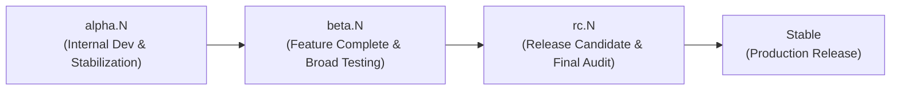

# Digital Books — Versioning Policy & Governance

Dokumen ini mendefinisikan standar versioning resmi untuk proyek **Digital Books**, sesuai prinsip arsitektur dan siklus rilis yang ditetapkan dalam `AGENTS.md`.

---

## 1. Skema & Format Versi

Digital Books menggunakan **Semantic Versioning 2.0.0** yang diselaraskan dengan spesifikasi versi Flutter/Dart pada `pubspec.yaml`:

```text
MAJOR.MINOR.PATCH-PRERELEASE+BUILD
```

### Komponen Versi

| Komponen | Penjelasan | Contoh |
| :--- | :--- | :--- |
| **MAJOR** | Perubahan arsitektur besar, breaking change pada database schema tanpa backward compatibility, atau perombakan total core engine. | `1.0.0`, `2.0.0` |
| **MINOR** | Penambahan fitur utama baru yang backward-compatible (misal: penambahan OCR engine, sync engine, atau reflowable reader). | `1.1.0`, `1.2.0` |
| **PATCH** | Perbaikan bug kritis, perbaikan visual kecil, atau penyesuaian dependensi pada versi stabil. | `1.0.1`, `1.1.1` |
| **PRERELEASE** | Fase pematangan rilis sebelum stabil: `alpha.N`, `beta.N`, `rc.N`. | `alpha.8`, `beta.1`, `rc.1` |
| **BUILD** | Angka integer mononoton naik yang merepresentasikan sequence build internal untuk distribusi macOS/iOS/Android. | `+9`, `+10` |

---

## 2. Tahapan Siklus Rilis (Lifecycle Stages)



### A. Tahap Alpha (`alpha.N`)
- **Tujuan**: Pengembangan aktif modul internal, refactor engine (misal: PaginationEngine, Pdfium C-FFI caching), dan integrasi pipeline dokumen.
- **Karakteristik**: Fitur baru sedang diuji secara intensif; stabilitas diukur dan dioptimalkan.
- **Aturan Kenaikan**: `alpha.1` $\to$ `alpha.2` $\to$ `alpha.N` pada setiap milestone terverifikasi.

### B. Tahap Beta (`beta.N`)
- **Tujuan**: Semua fitur inti untuk target versi telah selesai (*feature-freeze*). Pengujian difokuskan pada kenyamanan membaca manusia (*real-world reading session*), ketahanan data, dan konsumsi memori native.
- **Aturan Kenaikan**: `beta.1` $\to$ `beta.2` ketika ada perbaikan atas temuan pengujian beta.

### C. Tahap Release Candidate (`rc.N`)
- **Tujuan**: Tidak ada fitur baru. Hanya perbaikan *blocker/critical bug* yang diperbolehkan.
- **Aturan Kenaikan**: `rc.1` $\to$ `rc.2` jika ditemukan regresi pada kandidat rilis.

### D. Tahap Stable
- **Tujuan**: Rilis produksi yang siap digunakan secara harian oleh pengguna akhir.
- **Format**: `MAJOR.MINOR.PATCH+BUILD` (tanpa suffix prerelease, e.g., `1.1.0+40`).

---

## 3. Aturan Bump Versi

1. **Bukan Setiap Commit**:
   - Jangan menaikkan versi pada setiap micro-commit atau bug fix lokal.
   - Kenaikan versi hanya dilakukan saat sebuah milestone pengembangan mencapai checkpoint yang teruji dan siap dirilis atau didistribusikan.
2. **Kenaikan BUILD Number**:
   - BUILD number (`+BUILD`) **harus selalu bertambah** (monotonically increasing) setiap kali versi diperbarui di `pubspec.yaml`.
   - Contoh: `1.1.0-alpha.7+8` $\to$ `1.1.0-alpha.8+9`.
3. **Penyelarasan Berkas**:
   - Setiap kali versi dinaikkan di `pubspec.yaml`, riwayat perubahan wajib dicatat di `CHANGELOG.md` pada saat yang sama.
   - Versi di `pubspec.yaml` dan header di `CHANGELOG.md` harus konsisten secara identik.

---

## 4. Git Tagging & Release Branching

- **Tagging Format**:
  - Prerelease: `v1.1.0-alpha.8` (opsional, hanya jika diinstruksikan untuk build checkpoint).
  - Stable Release: `v1.1.0` (wajib untuk setiap rilis stabil).
- **Aturan Branch**:
  - `main`: Branch utama yang selalu dalam kondisi compilable dan seluruh automated test lulus (*evergreen*).
  - `release/*`: Branch pemotongan rilis stabil untuk hardening jika pengembangan fitur berikutnya sudah berjalan.
