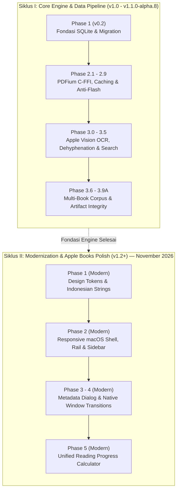

# Digital Books — Documentation Hub & Architecture Catalog

Selamat datang di direktori dokumentasi resmi **Digital Books**. Dokumen ini berfungsi sebagai peta navigasi utama, indeks arsitektur, dan katalog kronologis seluruh dokumen teknis, standar tata kelola (*governance*), spesifikasi sistem, serta laporan pengujian (*audit & benchmark reports*) proyek Digital Books.

---

## 1. Peta Jalan & Linimasa Dua Siklus (The Two-Cycle Evolution Roadmap)

Untuk memahami alur dan penomoran fase di Digital Books (mengapa terdapat **Phase 1, 2, dan 5 yang baru dikerjakan**, sementara **Phase 3.0 s.d. 3.9A merupakan fase lama**), perhatikan linimasa dua siklus pengembangan berikut:



### Penjelasan Dua Siklus Pengembangan:
1. **Siklus I — Core Engine & Document Pipeline (Fase Historis / v1.0 s.d. v1.1.0-alpha.8)**:
   - Dikerjakan selama fase perintisan arsitektur inti (Oktober – awal November 2026).
   - Fokus: Stabilitas rendering PDFium native, penghapusan *blank flash*, integrasi Apple Vision OCR lokal tanpa cloud, normalisasi paragraf bahasa Indonesia, dan pencarian semantik berkecepatan tinggi.
   - Lokasi berkas: [`docs/Reports/Historical Engine v1.1/`](file:///Users/davindalana/Documents/Project/Digital%20Books/docs/Reports/Historical%20Engine%20v1.1) dan [`docs/Reports/Release/`](file:///Users/davindalana/Documents/Project/Digital%20Books/docs/Reports/Release).
2. **Siklus II — Modernization & Apple Books Polish Initiative (Fase Terkini / v1.2+)**:
   - Berjalan aktif mulai **12 November 2026**.
   - Fokus: Peningkatan pengalaman desktop macOS asli (standar Apple Books), perancangan token desain (`AppThemeTokens`), tata letak adaptif pada 3 breakpoint (`compact`, `standard`, `expansive`), icon rail, sidebar native, dan kalkulator progres membaca yang mode-aware (`ReadingProgressCalculator`).
   - Lokasi berkas: [`docs/Reports/Modernization v1.2/`](file:///Users/davindalana/Documents/Project/Digital%20Books/docs/Reports/Modernization%20v1.2).

---

## 2. Struktur Direktori Dokumentasi Human-Readable

Seluruh nama folder dan berkas menggunakan nama bersih dengan spasi tanpa garis bawah (`_`):

```text
docs/
├── README.md                                  # Katalog Utama & Peta Navigasi
├── Governance/                                # Standar Tata Kelola & Aturan Rekayasa
│   ├── Development Workflow.md                # Siklus 13 Langkah Baku & Commit Policy
│   └── Versioning Policy.md                   # Spesifikasi SemVer 2.0.0 & Release Gates
├── Architecture/                              # Cetak Biru Sistem & Roadmap Desain
│   ├── Book Mode Finalization Roadmap.md      # Peta Jalan Penyelesaian Book Mode
│   ├── Complete Reading Experience Overhaul.md# Blueprint Redesain Tipografi & Layout
│   ├── Phase 3.0 Architecture.md              # Arsitektur Dual-Engine & Cache Bitmap
│   └── Phase 3.1 Architecture Plan.md         # Desain Pipeline OCR & Rekonstruksi Teks
├── Reports/                                   # Seluruh Laporan Validasi & Audit
│   ├── Modernization v1.2/                    # [SIKLUS II — TERKINI] Modernisasi UI/UX
│   │   ├── Phase 1 Design Tokens and Strings.md
│   │   ├── Phase 2 macOS Responsive Shell.md
│   │   └── Phase 5 Reading Progress Calculator.md
│   ├── Historical Engine v1.1/                # [SIKLUS I — HISTORIS] Pipeline Mesin
│   │   ├── Phase 3.0/                         # 13 Laporan Phase 3.0, 3.0.1, 3.0.1.1
│   │   ├── Phase 3.1/                         # 3 Laporan Apple Vision OCR
│   │   ├── Phase 3.2/                         # 2 Laporan In-Book Search & Traversal
│   │   ├── Phase 3.3/                         # 1 Laporan Anotasi & Sorotan
│   │   ├── Phase 3.5/                         # 4 Laporan Validasi Korpus Riil & Audit
│   │   └── Book Mode/                         # 5 Laporan Redesain Book Mode
│   └── Release/                               # Laporan Kandidat Rilis & UI Audits (3.6 - 3.9A)
└── visual_evidence/                           # Artefak Visual Tangkapan Layar Native macOS
```

---

## 3. Tata Kelola & Standar Rekayasa (`Governance/`)

| Dokumen | Deskripsi & Isi Utama | Tautan |
| :--- | :--- | :--- |
| **Development Workflow** | 13 langkah siklus pengembangan baku, Conventional Commits, aturan `CHANGELOG.md`, prosedur regression test, mitigasi rollback, dan proteksi integritas data. | [`Development Workflow.md`](file:///Users/davindalana/Documents/Project/Digital%20Books/docs/Governance/Development%20Workflow.md) |
| **Versioning Policy** | Skema SemVer 2.0.0 (`MAJOR.MINOR.PATCH-PRERELEASE+BUILD`), tahapan siklus rilis (Alpha, Beta, RC, Stable), dan aturan kenaikan nomor rilis. | [`Versioning Policy.md`](file:///Users/davindalana/Documents/Project/Digital%20Books/docs/Governance/Versioning%20Policy.md) |

---

## 4. Arsitektur & Spesifikasi Desain (`Architecture/`)

| Dokumen | Deskripsi & Cakupan | Tautan |
| :--- | :--- | :--- |
| **Phase 3.0 Architecture** | Spesifikasi Dual-Engine Reading System (Original PDFium C-FFI vs Reflowable TextPainter), layer caching bitmap dua tingkat, dan state management Riverpod. | [`Phase 3.0 Architecture.md`](file:///Users/davindalana/Documents/Project/Digital%20Books/docs/Architecture/Phase%203.0%20Architecture.md) |
| **Phase 3.1 Architecture Plan** | Arsitektur pipeline pemrosesan dokumen lokal: Image Enhancement LUT, Apple Vision OCR, dehyphenation bahasa Indonesia, dan Semantic Reconstruction. | [`Phase 3.1 Architecture Plan.md`](file:///Users/davindalana/Documents/Project/Digital%20Books/docs/Architecture/Phase%203.1%20Architecture%20Plan.md) |
| **Complete Reading Experience Overhaul** | Cetak biru perombakan total pengalaman membaca: estetika tipografi Apple Books, mode bentang halaman (single/two-page spread), dan fluid navigation. | [`Complete Reading Experience Overhaul.md`](file:///Users/davindalana/Documents/Project/Digital%20Books/docs/Architecture/Complete%20Reading%20Experience%20Overhaul.md) |
| **Book Mode Finalization Roadmap** | Peta jalan penyelesaian Book Mode: paginasi horizontal presisi kata, pembatasan orphan/widow, kalkulasi waktu tersisa bab, dan rendering spread adaptif. | [`Book Mode Finalization Roadmap.md`](file:///Users/davindalana/Documents/Project/Digital%20Books/docs/Architecture/Book%20Mode%20Finalization%20Roadmap.md) |

---

## 5. Laporan Inisiatif Modernisasi v1.2+ (`Reports/Modernization v1.2/`)

> [!NOTE]
> Ini adalah rangkaian fase modernisasi antarmuka dan pengalaman pengguna yang aktif dikembangkan pada **November 2026**.

| Dokumen | Topik & Cakupan | Tautan |
| :--- | :--- | :--- |
| **Phase 1: Design Tokens & Strings** | Sentralisasi skala spasi (`AppThemeTokens`), skala radius, konstanta breakpoint macOS, dan kamus terminologi UX Bahasa Indonesia baku (`AppStrings`). | [`Phase 1 Design Tokens and Strings.md`](file:///Users/davindalana/Documents/Project/Digital%20Books/docs/Reports/Modernization%20v1.2/Phase%201%20Design%20Tokens%20and%20Strings.md) |
| **Phase 2: macOS Responsive Shell** | Shell adaptif desktop macOS dengan 3 breakpoint (`compact < 700dp`, `standard 900dp`, `expansive >= 1280dp`), Icon Rail ramping ($64\text{ dp}$), Native Sidebar ($220\text{ dp}$), dan sinkronisasi rak buku aktif. | [`Phase 2 macOS Responsive Shell.md`](file:///Users/davindalana/Documents/Project/Digital%20Books/docs/Reports/Modernization%20v1.2/Phase%202%20macOS%20Responsive%20Shell.md) |
| **Phase 5: Reading Progress Calculator** | Kalkulator progres membaca mode-aware (`ReadingProgressCalculator`), pemisahan metrik fisik (PDF) vs semantik (Book Mode), dan estimasi waktu baca per bab. | [`Phase 5 Reading Progress Calculator.md`](file:///Users/davindalana/Documents/Project/Digital%20Books/docs/Reports/Modernization%20v1.2/Phase%205%20Reading%20Progress%20Calculator.md) |

---

## 6. Laporan Mesin & Pipeline Historis v1.1 (`Reports/Historical Engine v1.1/`)

### A. Fase 3.0 & 3.0.1 (`Phase 3.0/`)

| Dokumen | Kategori | Ringkasan Isi | Tautan |
| :--- | :--- | :--- | :--- |
| `Phase 3.0 Benchmark.md` | Benchmark | Pengukuran baseline performa render PDFium, alokasi memori, dan efisiensi paginasi awal. | [`Buka`](file:///Users/davindalana/Documents/Project/Digital%20Books/docs/Reports/Historical%20Engine%20v1.1/Phase%203.0/Phase%203.0%20Benchmark.md) |
| `Phase 3.0.1 Implementation.md` | Milestone | Implementasi stabilisasi cache bitmap ganda, eliminasi double white flash, dan unblocking gesture. | [`Buka`](file:///Users/davindalana/Documents/Project/Digital%20Books/docs/Reports/Historical%20Engine%20v1.1/Phase%203.0/Phase%203.0.1%20Implementation.md) |
| `Phase 3.0.1 Benchmark.md` | Benchmark | Tolok ukur latensi perpindahan halaman dan konsumsi RAM pasca perbaikan cache. | [`Buka`](file:///Users/davindalana/Documents/Project/Digital%20Books/docs/Reports/Historical%20Engine%20v1.1/Phase%203.0/Phase%203.0.1%20Benchmark.md) |
| `Phase 3.0.1 Reader Quality.md` | Quality | Evaluasi kualitas keterbacaan, pemilihan font macOS native, dan kontras warna pada 4 palet membaca. | [`Buka`](file:///Users/davindalana/Documents/Project/Digital%20Books/docs/Reports/Historical%20Engine%20v1.1/Phase%203.0/Phase%203.0.1%20Reader%20Quality.md) |
| `Phase 3.0.1 Semantic Reconstruction.md` | Engine | Validasi normalisasi paragraf, deteksi heading bab (H1–H3), dan penanganan tanda hubung kata ulang. | [`Buka`](file:///Users/davindalana/Documents/Project/Digital%20Books/docs/Reports/Historical%20Engine%20v1.1/Phase%203.0/Phase%203.0.1%20Semantic%20Reconstruction.md) |
| `Phase 3.0.1 PDF Transition Validation.md` | Validation | Uji transisi kurva kubik pada perpindahan halaman PDF ganda tanpa frame drop. | [`Buka`](file:///Users/davindalana/Documents/Project/Digital%20Books/docs/Reports/Historical%20Engine%20v1.1/Phase%203.0/Phase%203.0.1%20PDF%20Transition%20Validation.md) |
| `Phase 3.0.1 Performance.md` | Perf | Profiling CPU dan raster thread selama navigasi cepat 60 FPS pada monitor Retina. | [`Buka`](file:///Users/davindalana/Documents/Project/Digital%20Books/docs/Reports/Historical%20Engine%20v1.1/Phase%203.0/Phase%203.0.1%20Performance.md) |
| `Phase 3.0.1 Visual Validation.md` | Visual | Bukti tangkapan layar transisi halaman, rendering halaman ganda, dan visual palet tema. | [`Buka`](file:///Users/davindalana/Documents/Project/Digital%20Books/docs/Reports/Historical%20Engine%20v1.1/Phase%203.0/Phase%203.0.1%20Visual%20Validation.md) |
| `Phase 3.0.1 Final Acceptance.md` | Acceptance | Laporan kelayakan rilis checkpoint Phase 3.0.1 dengan 240/240 automated test passing. | [`Buka`](file:///Users/davindalana/Documents/Project/Digital%20Books/docs/Reports/Historical%20Engine%20v1.1/Phase%203.0/Phase%203.0.1%20Final%20Acceptance.md) |
| `Phase 3.0.1.1 Enhancement Fix.md` | Fix | Perbaikan algoritma tone-mapping S-curve LUT untuk dokumen pindaian fotokopi kontras rendah. | [`Buka`](file:///Users/davindalana/Documents/Project/Digital%20Books/docs/Reports/Historical%20Engine%20v1.1/Phase%203.0/Phase%203.0.1.1%20Enhancement%20Fix.md) |
| `Phase 3.0.1.1 Gutter Validation.md` | Validation | Validasi flattening kelengkungan gutter (punggung buku) pada buku pindaian tebal. | [`Buka`](file:///Users/davindalana/Documents/Project/Digital%20Books/docs/Reports/Historical%20Engine%20v1.1/Phase%203.0/Phase%203.0.1.1%20Gutter%20Validation.md) |
| `Phase 3.0.1.1 Native Transition Validation.md` | Validation | Validasi efek curl 3D native macOS dan retensi permukaan halaman selama animasi buka buku. | [`Buka`](file:///Users/davindalana/Documents/Project/Digital%20Books/docs/Reports/Historical%20Engine%20v1.1/Phase%203.0/Phase%203.0.1.1%20Native%20Transition%20Validation.md) |
| `Phase 3.0.1.1 Performance.md` | Perf | Pengukuran latensi enhancement LUT (18 ms per halaman 8.1 MB) di bawah anggaran 35 ms. | [`Buka`](file:///Users/davindalana/Documents/Project/Digital%20Books/docs/Reports/Historical%20Engine%20v1.1/Phase%203.0/Phase%203.0.1.1%20Performance.md) |

---

### B. Fase 3.1 s.d. 3.5 & Book Mode

| Folder & File | Kategori | Ringkasan Isi | Tautan |
| :--- | :--- | :--- | :--- |
| `Phase 3.1 OCR Acceptance.md` | Acceptance | Integrasi Apple Vision OCR lokal pada macOS tanpa cloud API. | [`Buka`](file:///Users/davindalana/Documents/Project/Digital%20Books/docs/Reports/Historical%20Engine%20v1.1/Phase%203.1/Phase%203.1%20OCR%20Acceptance.md) |
| `Phase 3.1.1 Full Book Acceptance.md` | Acceptance | Uji ekstraksi dan rekonstruksi semantik buku utuh multi-bab. | [`Buka`](file:///Users/davindalana/Documents/Project/Digital%20Books/docs/Reports/Historical%20Engine%20v1.1/Phase%203.1/Phase%203.1.1%20Full%20Book%20Acceptance.md) |
| `Phase 3.1.2 Full Book Reading Quality.md` | Quality | Audit tipografi, keterbacaan paragraf terjustifikasi, dan preservasi dialog. | [`Buka`](file:///Users/davindalana/Documents/Project/Digital%20Books/docs/Reports/Historical%20Engine%20v1.1/Phase%203.1/Phase%203.1.2%20Full%20Book%20Reading%20Quality.md) |
| `Phase 3.2 OCR Search.md` | Feature | Integrasi in-book search pada struktur semantik terekonstruksi. | [`Buka`](file:///Users/davindalana/Documents/Project/Digital%20Books/docs/Reports/Historical%20Engine%20v1.1/Phase%203.2/Phase%203.2%20OCR%20Search.md) |
| `Phase 3.2.1 Search Accuracy Audit.md` | Audit | Audit akurasi fuzzy match, bounding box PDF, dan navigasi siklis. | [`Buka`](file:///Users/davindalana/Documents/Project/Digital%20Books/docs/Reports/Historical%20Engine%20v1.1/Phase%203.2/Phase%203.2.1%20Search%20Accuracy%20Audit.md) |
| `Phase 3.3 Annotations Report.md` | Milestone | Text selection toolbar, palet sorotan 6-warna, dan panel catatan. | [`Buka`](file:///Users/davindalana/Documents/Project/Digital%20Books/docs/Reports/Historical%20Engine%20v1.1/Phase%203.3/Phase%203.3%20Annotations%20Report.md) |
| `Phase 3.5 Real World Product Validation.md` | Validation | Evaluasi performa OCR pada 7 kategori korpus buku riil. | [`Buka`](file:///Users/davindalana/Documents/Project/Digital%20Books/docs/Reports/Historical%20Engine%20v1.1/Phase%203.5/Phase%203.5%20Real%20World%20Product%20Validation.md) |
| `Phase 3.5.1 Independent Release Audit.md` | Audit | Audit independen: temuan dehyphenation (CRIT-01) dan metrik (CRIT-02). | [`Buka`](file:///Users/davindalana/Documents/Project/Digital%20Books/docs/Reports/Historical%20Engine%20v1.1/Phase%203.5/Phase%203.5.1%20Independent%20Release%20Audit.md) |
| `Phase 3.5.2 Remediation Verification.md` | Verification | Verifikasi penyelesaian temuan audit dengan tabel leksem tertutup. | [`Buka`](file:///Users/davindalana/Documents/Project/Digital%20Books/docs/Reports/Historical%20Engine%20v1.1/Phase%203.5/Phase%203.5.2%20Remediation%20Verification.md) |
| `Phase 3.5.3 Native and E2E Validation.md` | E2E | Uji kestabilan memori native dan penjelajahan dokumen panjang. | [`Buka`](file:///Users/davindalana/Documents/Project/Digital%20Books/docs/Reports/Historical%20Engine%20v1.1/Phase%203.5/Phase%203.5.3%20Native%20and%20E2E%20Validation.md) |
| `Book Mode Horizontal Pagination Report.md` | Milestone | Paginasi horizontal kolom ganda dan resolusi anchor kata presisi. | [`Buka`](file:///Users/davindalana/Documents/Project/Digital%20Books/docs/Reports/Historical%20Engine%20v1.1/Book%20Mode/Book%20Mode%20Horizontal%20Pagination%20Report.md) |
| `Book Mode Reading Experience Redesign Report.md` | Redesign | Redesain Book Mode bergaya buku cetak mewah (margin, drop cap, TOC leaders). | [`Buka`](file:///Users/davindalana/Documents/Project/Digital%20Books/docs/Reports/Historical%20Engine%20v1.1/Book%20Mode/Book%20Mode%20Reading%20Experience%20Redesign%20Report.md) |
| `Real Book Acceptance Report.md` | Acceptance | Uji visual buku riil bahasa Indonesia (Bab I–V, halaman legal). | [`Buka`](file:///Users/davindalana/Documents/Project/Digital%20Books/docs/Reports/Historical%20Engine%20v1.1/Book%20Mode/Real%20Book%20Acceptance%20Report.md) |
| `Final Product Acceptance Report.md` | Acceptance | Evaluasi kesiapan produk menyeluruh lintas mode membaca dan tema. | [`Buka`](file:///Users/davindalana/Documents/Project/Digital%20Books/docs/Reports/Historical%20Engine%20v1.1/Book%20Mode/Final%20Product%20Acceptance%20Report.md) |
| `Final Release Readiness Report.md` | Release | Pemeriksaan checklist akhir sebelum pembuatan Release Candidate. | [`Buka`](file:///Users/davindalana/Documents/Project/Digital%20Books/docs/Reports/Historical%20Engine%20v1.1/Book%20Mode/Final%20Release%20Readiness%20Report.md) |

---

## 7. Laporan Rilis & Audit Mandiri (`Reports/Release/`)

| Dokumen | Kategori | Ringkasan Isi | Tautan |
| :--- | :--- | :--- | :--- |
| `Phase 3.6 Release Candidate Report.md` | Release Candidate | Laporan Release Candidate Phase 3.6 dengan uji multi-buku 1.238 halaman. | [`Buka`](file:///Users/davindalana/Documents/Project/Digital%20Books/docs/Reports/Release/Phase%203.6%20Release%20Candidate%20Report.md) |
| `Phase 3.7 Independent Audit Report.md` | Audit | Audit verifikasi independen atas metrik evaluasi buku dan pemurnian test suite Phase 3.6. | [`Buka`](file:///Users/davindalana/Documents/Project/Digital%20Books/docs/Reports/Release/Phase%203.7%20Independent%20Audit%20Report.md) |
| `Phase 3.8 Artifact Integrity Report.md` | Integrity | Uji integritas backup, restore, dan relink PDF pada format bundle mandiri. | [`Buka`](file:///Users/davindalana/Documents/Project/Digital%20Books/docs/Reports/Release/Phase%203.8%20Artifact%20Integrity%20Report.md) |
| `Phase 3.9A OCR Pilot Report.md` | Pilot | Uji percontohan throughput pemrosesan background OCR berbasis Apple Vision pada macOS. | [`Buka`](file:///Users/davindalana/Documents/Project/Digital%20Books/docs/Reports/Release/Phase%203.9A%20OCR%20Pilot%20Report.md) |
| `Phase 3.9A Reader UI Audit.md` | UI Audit | Audit ergonomi UI layar pembaca, hierarchy tombol, dan konsistensi status bar. | [`Buka`](file:///Users/davindalana/Documents/Project/Digital%20Books/docs/Reports/Release/Phase%203.9A%20Reader%20UI%20Audit.md) |
| `Reader Minimalist UI Report.md` | UI Design | Implementasi antarmuka baca minimalis dengan auto-hide bar atas dan indikator hover tepi. | [`Buka`](file:///Users/davindalana/Documents/Project/Digital%20Books/docs/Reports/Release/Reader%20Minimalist%20UI%20Report.md) |
| `Reader Typography Refinement Report.md` | Typography | Pemurnian tipografi, pengaturan spasi baris, dan penyesuaian font multi-resolusi. | [`Buka`](file:///Users/davindalana/Documents/Project/Digital%20Books/docs/Reports/Release/Reader%20Typography%20Refinement%20Report.md) |

---

## 8. Bukti Visual Pengujian (`visual_evidence/`)

> [!IMPORTANT]
> **Dilarang memindahkan atau mengubah nama direktori `docs/visual_evidence/`!**
> Direktori ini diakses secara langsung oleh rangkaian tes otomatis (`test/*_test.dart`) dan alat native Swift (`tools/capture_native_windows.swift`) untuk memverifikasi regresi visual tata letak macOS.

Sub-direktori bukti visual:
- `phase_2_shell/` & `phase_2_native/`: Screenshot shell window macOS responsive (compact 700dp, standard 900dp, expansive 1280dp) yang dihasilkan dari inisiatif modernisasi Siklus II.
- `book_mode_acceptance/`: Tangkapan layar spread bab 1–5 Book Mode.
- `book_mode_redesign/`: Perbandingan before/after perombakan tampilan Book Mode.
- `enhancement_fix/`: Visual komparasi preset enhancement (Gentle, Balanced, Strong, Original).
- `minimalist_ui/`: Bukti visual auto-hide controls, hover strip, tema, dan responsivitas window.
- `native_transitions/`: Frame demi frame kurva kubik transisi curl native (0 ms hingga 340 ms).
- `phase_3_1_1/` & `phase_3_1_2/`: Bukti visual perbandingan scan asli vs reflowable layout.
- `phase_3_2/` & `phase_3_2_1/`: Visual in-book search, highlight traversal, dan cycling match.
- `phase_3_3/`: Visual text selection toolbar, color picker 6-warna, dan panel anotasi.
- `phase_3_5/` & `phase_3_6/`: Visual korpus uji buku nyata multi-genre.
- `scan_enhancement/`: Bukti filter kontras dan penghapusan paper noise.
- `transitions/`: Sequence transisi spread rendering PDFium.

---

## 9. Pedoman Penulisan Dokumentasi Baru

Setiap penambahan dokumen baru wajib mengikuti konvensi berikut:

1. **Format Nama Berkas & Folder**:
   - Gunakan format judul bersih menggunakan spasi tanpa karakter garis bawah (`_`), contoh: `Phase 4 Native Transitions.md`.
2. **Penentuan Lokasi Folder**:
   - Standar & Tata Kelola $\to$ `docs/Governance/`
   - Spesifikasi Arsitektur / Blueprint $\to$ `docs/Architecture/`
   - Laporan Inisiatif Modernisasi (v1.2+) $\to$ `docs/Reports/Modernization v1.2/`
   - Laporan Pipeline Mesin Historis (v1.1) $\to$ `docs/Reports/Historical Engine v1.1/`
   - Laporan Release Candidate $\to$ `docs/Reports/Release/`
   - Screenshot Uji Coba $\to$ `docs/visual_evidence/<kategori>/`
3. **Format Metadata Dokumen**:
   Sertakan blok metadata pada awal setiap laporan:
   ```markdown
   # Judul Dokumen

   > **Metadata Dokumen**
   > - **Siklus / Inisiatif**: Siklus II — Modernization & Apple Books Polish (v1.2+)
   > - **Fase**: Phase X (...)
   > - **Tanggal**: DD MMMM YYYY
   > - **Status Verifikasi**: PASS / CONDITIONAL PASS / FAIL
   ```
4. **Pencatatan ke Indeks**:
   - Daftarkan dokumen baru ke tabel yang relevan di dalam `docs/README.md`.
