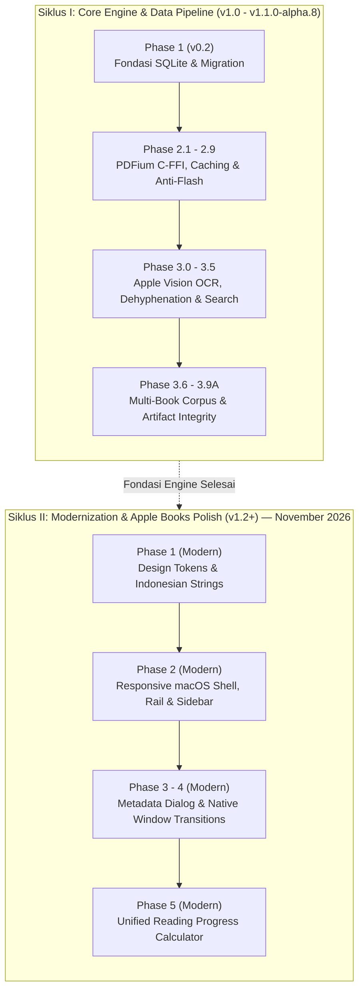

# Digital Books — Documentation Hub & Architecture Catalog

Selamat datang di direktori dokumentasi resmi **Digital Books**. Dokumen ini berfungsi sebagai peta navigasi utama, indeks arsitektur, dan katalog kronologis seluruh dokumen teknis, standar tata kelola (*governance*), spesifikasi sistem, serta laporan pengujian (*audit & benchmark reports*) proyek Digital Books.

---

## 1. Peta Jalan & Linimasa Dua Siklus (The Two-Cycle Evolution Roadmap)

Untuk memahami penomoran fase di Digital Books (mengapa terdapat **Phase 1, 2, dan 5 yang baru** dibuat, sementara **Phase 3.0 s.d. 3.9A merupakan fase lama**), perhatikan linimasa dua siklus pengembangan berikut:



### Ringkasan Kedua Siklus:
1. **Siklus I — Core Engine & Document Pipeline (Fase Historis / v1.0 s.d. v1.1.0-alpha.8)**:
   - Berlangsung selama fase pembentukan arsitektur inti (Oktober – awal November 2026).
   - Fokus: Stabilitas rendering PDFium native, penghapusan *blank flash*, integrasi OCR lokal tanpa cloud, normalisasi paragraf bahasa Indonesia, dan pencarian semantik berkecepatan tinggi.
   - Disimpan di: [`docs/reports/historical_engine_v1_1/`](file:///Users/davindalana/Documents/Project/Digital%20Books/docs/reports/historical_engine_v1_1) dan [`docs/reports/release/`](file:///Users/davindalana/Documents/Project/Digital%20Books/docs/reports/release).
2. **Siklus II — Modernization & Apple Books Polish Initiative (Fase Terkini / v1.2+)**:
   - Berjalan aktif mulai **12 November 2026**.
   - Fokus: Peningkatan pengalaman desktop macOS asli (standar Apple Books), perancangan sistem token desain (`AppThemeTokens`), tata letak adaptif pada 3 breakpoint (`compact`, `standard`, `expansive`), dan kalkulator progres membaca yang mode-aware (`ReadingProgressCalculator`).
   - Disimpan di: [`docs/reports/modernization_v1_2/`](file:///Users/davindalana/Documents/Project/Digital%20Books/docs/reports/modernization_v1_2).

---

## 2. Struktur Modular Direktori Dokumentasi

Seluruh dokumen di dalam `docs/` menggunakan penamaan seragam **`lowercase_snake_case.md`**:

```text
docs/
├── README.md                                  # Katalog Utama & Peta Navigasi
├── governance/                                # Standar Tata Kelola & Aturan Rekayasa
│   ├── development_workflow.md                # Siklus 13 Langkah Baku & Commit Policy
│   └── versioning_policy.md                   # Spesifikasi SemVer 2.0.0 & Release Gates
├── architecture/                              # Cetak Biru Sistem & Roadmap Desain
│   ├── book_mode_finalization_roadmap.md      # Peta Jalan Penyelesaian Book Mode
│   ├── complete_reading_experience_overhaul.md# Blueprint Redesain Tipografi & Layout
│   ├── phase_3_0_architecture.md              # Arsitektur Dual-Engine & Cache Bitmap
│   └── phase_3_1_architecture_plan.md         # Desain Pipeline OCR & Rekonstruksi Teks
├── reports/                                   # Seluruh Laporan Validasi & Audit
│   ├── modernization_v1_2/                    # [SIKLUS II — TERKINI] Modernisasi UI/UX
│   │   ├── phase_1_design_tokens_and_strings.md
│   │   ├── phase_2_macos_responsive_shell.md
│   │   └── phase_5_reading_progress_calculator.md
│   ├── historical_engine_v1_1/                # [SIKLUS I — HISTORIS] Pipeline Mesin
│   │   ├── phase_3_0/                         # 13 Laporan Phase 3.0, 3.0.1, 3.0.1.1
│   │   ├── phase_3_1/                         # 3 Laporan Apple Vision OCR
│   │   ├── phase_3_2/                         # 2 Laporan In-Book Search & Traversal
│   │   ├── phase_3_3/                         # 1 Laporan Anotasi & Sorotan
│   │   ├── phase_3_5/                         # 4 Laporan Validasi Korpus Riil & Audit
│   │   └── book_mode/                         # 5 Laporan Redesain Book Mode
│   └── release/                               # Laporan Kandidat Rilis & UI Audits (3.6 - 3.9A)
└── visual_evidence/                           # Artefak Visual Tangkapan Layar Native macOS
```

---

## 3. Tata Kelola & Standar Rekayasa (`governance/`)

| Dokumen | Deskripsi & Isi Utama | Tautan |
| :--- | :--- | :--- |
| **Development Workflow** | 13 langkah siklus pengembangan baku, Conventional Commits, aturan `CHANGELOG.md`, prosedur regression test, mitigasi rollback, dan proteksi integritas data. | [`development_workflow.md`](file:///Users/davindalana/Documents/Project/Digital%20Books/docs/governance/development_workflow.md) |
| **Versioning Policy** | Skema SemVer 2.0.0 (`MAJOR.MINOR.PATCH-PRERELEASE+BUILD`), tahapan siklus rilis (Alpha, Beta, RC, Stable), dan aturan kenaikan nomor rilis. | [`versioning_policy.md`](file:///Users/davindalana/Documents/Project/Digital%20Books/docs/governance/versioning_policy.md) |

---

## 4. Arsitektur & Spesifikasi Desain (`architecture/`)

| Dokumen | Deskripsi & Cakupan | Tautan |
| :--- | :--- | :--- |
| **Phase 3.0 Architecture** | Spesifikasi Dual-Engine Reading System (Original PDFium C-FFI vs Reflowable TextPainter), layer caching bitmap dua tingkat, dan state management Riverpod. | [`phase_3_0_architecture.md`](file:///Users/davindalana/Documents/Project/Digital%20Books/docs/architecture/phase_3_0_architecture.md) |
| **Phase 3.1 Architecture Plan** | Arsitektur pipeline pemrosesan dokumen lokal: Image Enhancement LUT, Apple Vision OCR, dehyphenation bahasa Indonesia, dan Semantic Reconstruction. | [`phase_3_1_architecture_plan.md`](file:///Users/davindalana/Documents/Project/Digital%20Books/docs/architecture/phase_3_1_architecture_plan.md) |
| **Complete Reading Experience Overhaul** | Cetak biru perombakan total pengalaman membaca: estetika tipografi Apple Books, mode bentang halaman (single/two-page spread), dan fluid navigation. | [`complete_reading_experience_overhaul.md`](file:///Users/davindalana/Documents/Project/Digital%20Books/docs/architecture/complete_reading_experience_overhaul.md) |
| **Book Mode Finalization Roadmap** | Peta jalan penyelesaian Book Mode: paginasi horizontal presisi kata, pembatasan orphan/widow, kalkulasi waktu tersisa bab, dan rendering spread adaptif. | [`book_mode_finalization_roadmap.md`](file:///Users/davindalana/Documents/Project/Digital%20Books/docs/architecture/book_mode_finalization_roadmap.md) |

---

## 5. Laporan Inisiatif Modernisasi v1.2+ (`reports/modernization_v1_2/`)

> [!NOTE]
> Ini adalah rangkaian fase modernisasi antarmuka dan pengalaman pengguna yang aktif dikembangkan pada **November 2026**.

| Dokumen | Topik & Cakupan | Tautan |
| :--- | :--- | :--- |
| **Phase 1: Design Tokens & Strings** | Sentralisasi skala spasi (`AppThemeTokens`), skala radius, konstanta breakpoint macOS, dan kamus terminologi UX Bahasa Indonesia baku (`AppStrings`). | [`phase_1_design_tokens_and_strings.md`](file:///Users/davindalana/Documents/Project/Digital%20Books/docs/reports/modernization_v1_2/phase_1_design_tokens_and_strings.md) |
| **Phase 2: macOS Responsive Shell** | Shell adaptif desktop macOS dengan 3 breakpoint (`compact < 700dp`, `standard 900dp`, `expansive >= 1280dp`), Icon Rail ramping ($64\text{ dp}$), Native Sidebar ($220\text{ dp}$), dan sinkronisasi rak buku aktif. | [`phase_2_macos_responsive_shell.md`](file:///Users/davindalana/Documents/Project/Digital%20Books/docs/reports/modernization_v1_2/phase_2_macos_responsive_shell.md) |
| **Phase 5: Reading Progress Calculator** | Kalkulator progres membaca mode-aware (`ReadingProgressCalculator`), pemisahan metrik fisik (PDF) vs semantik (Book Mode), dan estimasi waktu baca per bab. | [`phase_5_reading_progress_calculator.md`](file:///Users/davindalana/Documents/Project/Digital%20Books/docs/reports/modernization_v1_2/phase_5_reading_progress_calculator.md) |

---

## 6. Laporan Mesin & Pipeline Historis v1.1 (`reports/historical_engine_v1_1/`)

### A. Fase 3.0 & 3.0.1 (`historical_engine_v1_1/phase_3_0/`)

| Dokumen | Kategori | Ringkasan Isi | Tautan |
| :--- | :--- | :--- | :--- |
| `phase_3_0_benchmark.md` | Benchmark | Pengukuran baseline performa render PDFium, alokasi memori, dan efisiensi paginasi awal. | [`Buka`](file:///Users/davindalana/Documents/Project/Digital%20Books/docs/reports/historical_engine_v1_1/phase_3_0/phase_3_0_benchmark.md) |
| `phase_3_0_1_implementation.md` | Milestone | Implementasi stabilisasi cache bitmap ganda, eliminasi double white flash, dan unblocking gesture. | [`Buka`](file:///Users/davindalana/Documents/Project/Digital%20Books/docs/reports/historical_engine_v1_1/phase_3_0/phase_3_0_1_implementation.md) |
| `phase_3_0_1_benchmark.md` | Benchmark | Tolok ukur latensi perpindahan halaman dan konsumsi RAM pasca perbaikan cache. | [`Buka`](file:///Users/davindalana/Documents/Project/Digital%20Books/docs/reports/historical_engine_v1_1/phase_3_0/phase_3_0_1_benchmark.md) |
| `phase_3_0_1_reader_quality.md` | Quality | Evaluasi kualitas keterbacaan, pemilihan font macOS native, dan kontras warna pada 4 palet membaca. | [`Buka`](file:///Users/davindalana/Documents/Project/Digital%20Books/docs/reports/historical_engine_v1_1/phase_3_0/phase_3_0_1_reader_quality.md) |
| `phase_3_0_1_semantic_reconstruction.md` | Engine | Validasi normalisasi paragraf, deteksi heading bab (H1–H3), dan penanganan tanda hubung kata ulang. | [`Buka`](file:///Users/davindalana/Documents/Project/Digital%20Books/docs/reports/historical_engine_v1_1/phase_3_0/phase_3_0_1_semantic_reconstruction.md) |
| `phase_3_0_1_pdf_transition_validation.md` | Validation | Uji transisi kurva kubik pada perpindahan halaman PDF ganda tanpa frame drop. | [`Buka`](file:///Users/davindalana/Documents/Project/Digital%20Books/docs/reports/historical_engine_v1_1/phase_3_0/phase_3_0_1_pdf_transition_validation.md) |
| `phase_3_0_1_performance.md` | Perf | Profiling CPU dan raster thread selama navigasi cepat 60 FPS pada monitor Retina. | [`Buka`](file:///Users/davindalana/Documents/Project/Digital%20Books/docs/reports/historical_engine_v1_1/phase_3_0/phase_3_0_1_performance.md) |
| `phase_3_0_1_visual_validation.md` | Visual | Bukti tangkapan layar transisi halaman, rendering halaman ganda, dan visual palet tema. | [`Buka`](file:///Users/davindalana/Documents/Project/Digital%20Books/docs/reports/historical_engine_v1_1/phase_3_0/phase_3_0_1_visual_validation.md) |
| `phase_3_0_1_final_acceptance.md` | Acceptance | Laporan kelayakan rilis checkpoint Phase 3.0.1 dengan 240/240 automated test passing. | [`Buka`](file:///Users/davindalana/Documents/Project/Digital%20Books/docs/reports/historical_engine_v1_1/phase_3_0/phase_3_0_1_final_acceptance.md) |
| `phase_3_0_1_1_enhancement_fix.md` | Fix | Perbaikan algoritma tone-mapping S-curve LUT untuk dokumen pindaian fotokopi kontras rendah. | [`Buka`](file:///Users/davindalana/Documents/Project/Digital%20Books/docs/reports/historical_engine_v1_1/phase_3_0/phase_3_0_1_1_enhancement_fix.md) |
| `phase_3_0_1_1_gutter_validation.md` | Validation | Validasi flattening kelengkungan gutter (punggung buku) pada buku pindaian tebal. | [`Buka`](file:///Users/davindalana/Documents/Project/Digital%20Books/docs/reports/historical_engine_v1_1/phase_3_0/phase_3_0_1_1_gutter_validation.md) |
| `phase_3_0_1_1_native_transition_validation.md` | Validation | Validasi efek curl 3D native macOS dan retensi permukaan halaman selama animasi buka buku. | [`Buka`](file:///Users/davindalana/Documents/Project/Digital%20Books/docs/reports/historical_engine_v1_1/phase_3_0/phase_3_0_1_1_native_transition_validation.md) |
| `phase_3_0_1_1_performance.md` | Perf | Pengukuran latensi enhancement LUT (18 ms per halaman 8.1 MB) di bawah anggaran 35 ms. | [`Buka`](file:///Users/davindalana/Documents/Project/Digital%20Books/docs/reports/historical_engine_v1_1/phase_3_0/phase_3_0_1_1_performance.md) |

---

### B. Fase 3.1 s.d. 3.5 & Book Mode (`historical_engine_v1_1/`)

| Folder & File | Kategori | Ringkasan Isi | Tautan |
| :--- | :--- | :--- | :--- |
| `phase_3_1_ocr_acceptance.md` | Acceptance | Integrasi Apple Vision OCR lokal pada macOS tanpa cloud API. | [`Buka`](file:///Users/davindalana/Documents/Project/Digital%20Books/docs/reports/historical_engine_v1_1/phase_3_1/phase_3_1_ocr_acceptance.md) |
| `phase_3_1_1_full_book_acceptance.md` | Acceptance | Uji ekstraksi dan rekonstruksi semantik buku utuh multi-bab. | [`Buka`](file:///Users/davindalana/Documents/Project/Digital%20Books/docs/reports/historical_engine_v1_1/phase_3_1/phase_3_1_1_full_book_acceptance.md) |
| `phase_3_1_2_full_book_reading_quality.md` | Quality | Audit tipografi, keterbacaan paragraf terjustifikasi, dan preservasi dialog. | [`Buka`](file:///Users/davindalana/Documents/Project/Digital%20Books/docs/reports/historical_engine_v1_1/phase_3_1/phase_3_1_2_full_book_reading_quality.md) |
| `phase_3_2_ocr_search.md` | Feature | Integrasi in-book search pada struktur semantik terekonstruksi. | [`Buka`](file:///Users/davindalana/Documents/Project/Digital%20Books/docs/reports/historical_engine_v1_1/phase_3_2/phase_3_2_ocr_search.md) |
| `phase_3_2_1_search_accuracy_audit.md` | Audit | Audit akurasi fuzzy match, bounding box PDF, dan navigasi siklis. | [`Buka`](file:///Users/davindalana/Documents/Project/Digital%20Books/docs/reports/historical_engine_v1_1/phase_3_2/phase_3_2_1_search_accuracy_audit.md) |
| `phase_3_3_annotations_report.md` | Milestone | Text selection toolbar, palet sorotan 6-warna, dan panel catatan. | [`Buka`](file:///Users/davindalana/Documents/Project/Digital%20Books/docs/reports/historical_engine_v1_1/phase_3_3/phase_3_3_annotations_report.md) |
| `phase_3_5_real_world_product_validation.md` | Validation | Evaluasi performa OCR pada 7 kategori korpus buku riil. | [`Buka`](file:///Users/davindalana/Documents/Project/Digital%20Books/docs/reports/historical_engine_v1_1/phase_3_5/phase_3_5_real_world_product_validation.md) |
| `phase_3_5_1_independent_release_audit.md` | Audit | Audit independen: temuan dehyphenation (CRIT-01) dan metrik (CRIT-02). | [`Buka`](file:///Users/davindalana/Documents/Project/Digital%20Books/docs/reports/historical_engine_v1_1/phase_3_5/phase_3_5_1_independent_release_audit.md) |
| `phase_3_5_2_remediation_verification.md` | Verification | Verifikasi penyelesaian temuan audit dengan tabel leksem tertutup. | [`Buka`](file:///Users/davindalana/Documents/Project/Digital%20Books/docs/reports/historical_engine_v1_1/phase_3_5/phase_3_5_2_remediation_verification.md) |
| `phase_3_5_3_native_and_e2e_validation.md` | E2E | Uji kestabilan memori native dan penjelajahan dokumen panjang. | [`Buka`](file:///Users/davindalana/Documents/Project/Digital%20Books/docs/reports/historical_engine_v1_1/phase_3_5/phase_3_5_3_native_and_e2e_validation.md) |
| `book_mode_horizontal_pagination_report.md` | Milestone | Paginasi horizontal kolom ganda dan resolusi anchor kata presisi. | [`Buka`](file:///Users/davindalana/Documents/Project/Digital%20Books/docs/reports/historical_engine_v1_1/book_mode/book_mode_horizontal_pagination_report.md) |
| `book_mode_reading_experience_redesign_report.md` | Redesign | Redesain Book Mode bergaya buku cetak mewah (margin, drop cap, TOC leaders). | [`Buka`](file:///Users/davindalana/Documents/Project/Digital%20Books/docs/reports/historical_engine_v1_1/book_mode/book_mode_reading_experience_redesign_report.md) |
| `real_book_acceptance_report.md` | Acceptance | Uji visual buku riil bahasa Indonesia (Bab I–V, halaman legal). | [`Buka`](file:///Users/davindalana/Documents/Project/Digital%20Books/docs/reports/historical_engine_v1_1/book_mode/real_book_acceptance_report.md) |
| `final_product_acceptance_report.md` | Acceptance | Evaluasi kesiapan produk menyeluruh lintas mode membaca dan tema. | [`Buka`](file:///Users/davindalana/Documents/Project/Digital%20Books/docs/reports/historical_engine_v1_1/book_mode/final_product_acceptance_report.md) |
| `final_release_readiness_report.md` | Release | Pemeriksaan checklist akhir sebelum pembuatan Release Candidate. | [`Buka`](file:///Users/davindalana/Documents/Project/Digital%20Books/docs/reports/historical_engine_v1_1/book_mode/final_release_readiness_report.md) |

---

## 7. Laporan Rilis & Audit Mandiri (`reports/release/`)

| Dokumen | Kategori | Ringkasan Isi | Tautan |
| :--- | :--- | :--- | :--- |
| `phase_3_6_release_candidate_report.md` | Release Candidate | Laporan Release Candidate Phase 3.6 dengan uji multi-buku 1.238 halaman. | [`Buka`](file:///Users/davindalana/Documents/Project/Digital%20Books/docs/reports/release/phase_3_6_release_candidate_report.md) |
| `phase_3_7_independent_audit_report.md` | Audit | Audit verifikasi independen atas metrik evaluasi buku dan pemurnian test suite Phase 3.6. | [`Buka`](file:///Users/davindalana/Documents/Project/Digital%20Books/docs/reports/release/phase_3_7_independent_audit_report.md) |
| `phase_3_8_artifact_integrity_report.md` | Integrity | Uji integritas backup, restore, dan relink PDF pada format bundle mandiri. | [`Buka`](file:///Users/davindalana/Documents/Project/Digital%20Books/docs/reports/release/phase_3_8_artifact_integrity_report.md) |
| `phase_3_9a_ocr_pilot_report.md` | Pilot | Uji percontohan throughput pemrosesan background OCR berbasis Apple Vision pada macOS. | [`Buka`](file:///Users/davindalana/Documents/Project/Digital%20Books/docs/reports/release/phase_3_9a_ocr_pilot_report.md) |
| `phase_3_9a_reader_ui_audit.md` | UI Audit | Audit ergonomi UI layar pembaca, hierarchy tombol, dan konsistensi status bar. | [`Buka`](file:///Users/davindalana/Documents/Project/Digital%20Books/docs/reports/release/phase_3_9a_reader_ui_audit.md) |
| `reader_minimalist_ui_report.md` | UI Design | Implementasi antarmuka baca minimalis dengan auto-hide bar atas dan indikator hover tepi. | [`Buka`](file:///Users/davindalana/Documents/Project/Digital%20Books/docs/reports/release/reader_minimalist_ui_report.md) |
| `reader_typography_refinement_report.md` | Typography | Pemurnian tipografi, pengaturan spasi baris, dan penyesuaian font multi-resolusi. | [`Buka`](file:///Users/davindalana/Documents/Project/Digital%20Books/docs/reports/release/reader_typography_refinement_report.md) |

---

## 8. Bukti Visual Pengujian (`visual_evidence/`)

> [!IMPORTANT]
> **Dilarang memindahkan atau menghapus direktori `docs/visual_evidence/`!**
> Direktori ini diakses secara langsung oleh test suite otomatis (`test/*_test.dart`) dan alat native Swift (`tools/capture_native_windows.swift`) untuk memverifikasi regresi visual tata letak macOS.

Sub-direktori bukti visual:
- `phase_2_shell/` & `phase_2_native/`: Screenshot shell window macOS responsive (compact 700dp, standard 900dp, expansive 1280dp) yang dihasilkan dari inisiatif modernisasi Siklus II.
- `book_mode_acceptance/`: Tangkapan layar spread bab 1–5 Book Mode.
- `book_mode_redesign/`: Perbandingan before/after perombakan tampilan Book Mode.
- `enhancement_fix/`: Visual komparasi preset enhancement (Gentle, Balanced, Strong, Original).
- `minimalist_ui/`: Bukti visual auto-hide controls, hover strip, tema, dan responsivitas window.
- `native_transitions/`: Frame demi frame kurva kubik transisi curl native (0 ms hingga 340 ms).
- `phase_3_1_1/` & `phase_3_1_2/`: Bukti visual perbandingan scan asli vs reflowable layout.
- `phase_3_2/` & `phase_3_2_1/`: Visual in-book search, highlight traversal, dan cycling match.
- `phase_3_3/`: Visual text selection toolbar, color picker 6-warna, dan panel anotasi.
- `phase_3_5/` & `phase_3_6/`: Visual korpus uji buku nyata multi-genre.
- `scan_enhancement/`: Bukti filter kontras dan penghapusan paper noise.
- `transitions/`: Sequence transisi spread rendering PDFium.

---

## 9. Pedoman Penulisan Dokumentasi Baru

Setiap penambahan dokumen baru wajib mengikuti konvensi berikut:

1. **Format Nama Berkas**:
   - Selalu gunakan format huruf kecil snake_case: **`lowercase_snake_case.md`** (contoh: `phase_4_native_transitions.md`).
2. **Penentuan Lokasi Folder**:
   - Standar & Tata Kelola $\to$ `docs/governance/`
   - Spesifikasi Arsitektur / Blueprint $\to$ `docs/architecture/`
   - Laporan Inisiatif Modernisasi (v1.2+) $\to$ `docs/reports/modernization_v1_2/`
   - Laporan Pipeline Mesin Historis (v1.1) $\to$ `docs/reports/historical_engine_v1_1/`
   - Laporan Release Candidate $\to$ `docs/reports/release/`
   - Screenshot Uji Coba $\to$ `docs/visual_evidence/<kategori>/`
3. **Format Metadata Dokumen**:
   Sertakan blok metadata pada awal setiap laporan:
   ```markdown
   # Judul Dokumen

   > **Metadata Dokumen**
   > - **Siklus / Inisiatif**: Siklus II — Modernization & Apple Books Polish (v1.2+)
   > - **Fase**: Phase X (...)
   > - **Tanggal**: DD MMMM YYYY
   > - **Status Verifikasi**: PASS / CONDITIONAL PASS / FAIL
   ```
4. **Pencatatan ke Indeks**:
   - Daftarkan dokumen baru ke tabel yang relevan di dalam `docs/README.md`.
