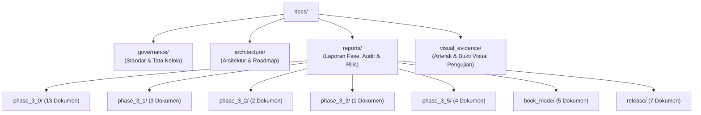

# Digital Books — Documentation Hub & Catalog

Selamat datang di direktori dokumentasi resmi **Digital Books**. Dokumen ini berfungsi sebagai peta navigasi utama, indeks arsitektur, dan katalog seluruh dokumen teknis, standar tata kelola (*governance*), spesifikasi sistem, serta laporan pengujian (*audit & benchmark reports*) proyek Digital Books.

---

## 1. Prinsip Utama Pengembangan (Core Principles)

Sesuai mandat [`AGENTS.md`](file:///Users/davindalana/Documents/Project/Digital%20Books/AGENTS.md):
1. **Local-first**: Data, database, dan pemrosesan berpusat pada mesin pengguna tanpa dependensi awan wajib.
2. **Immutabilitas Dokumen Asli**: Berkas PDF asli tidak boleh ditimpa atau dimodifikasi; seluruh OCR dan enhancement menghasilkan artefak turunan (*derived artifacts*).
3. **Stabilitas Posisi Membaca**: Perubahan ukuran jendela, font, atau orientasi tidak boleh merusak posisi membaca (*reading anchor*).
4. **Preservasi Anotasi**: Modifikasi tata letak atau reflow teks tidak boleh merusak koordinat sorotan (*highlights*), catatan (*notes*), atau markah buku (*bookmarks*).
5. **Verifikasi Kinerja Terukur**: Performa diukur secara empiris dengan metrik konkret (CPU, memori, frame time), bukan asumsi.
6. **Validasi Visual Native**: Pengujian harus dibuktikan pada aplikasi native macOS, bukan sekadar unit test.

---

## 2. Peta Struktur Direktori Dokumentasi

Direktori `docs/` telah ditata secara modular dan hierarkis:

Ringkasan struktur folder:
- [`governance/`](file:///Users/davindalana/Documents/Project/Digital%20Books/docs/governance): Standar siklus pengembangan baku, Conventional Commits, dan kebijakan versioning Semantic Versioning.
- [`architecture/`](file:///Users/davindalana/Documents/Project/Digital%20Books/docs/architecture): Rencana teknis, model dokumen semantik, dan cetak biru perombakan sistem membaca.
- [`reports/`](file:///Users/davindalana/Documents/Project/Digital%20Books/docs/reports): Laporan verifikasi, audit independen, uji regresi, dan tolok ukur performa tiap fase.
- [`visual_evidence/`](file:///Users/davindalana/Documents/Project/Digital%20Books/docs/visual_evidence): Tangkapan layar resolusi tinggi yang dihasilkan oleh test suite native macOS.

---

## 3. Tata Kelola & Standar Rekayasa (`governance/`)

| Dokumen | Topik & Cakupan | Tautan |
| :--- | :--- | :--- |
| **Development Workflow** | 13 langkah siklus pengembangan baku, Conventional Commits, aturan `CHANGELOG.md`, prosedur regression test, mitigasi rollback, dan proteksi integritas data. | [`DEVELOPMENT_WORKFLOW.md`](file:///Users/davindalana/Documents/Project/Digital%20Books/docs/governance/DEVELOPMENT_WORKFLOW.md) |
| **Versioning Policy** | Skema SemVer 2.0.0 (`MAJOR.MINOR.PATCH-PRERELEASE+BUILD`), tahapan siklus rilis (Alpha, Beta, RC, Stable), dan aturan kenaikan nomor rilis. | [`VERSIONING.md`](file:///Users/davindalana/Documents/Project/Digital%20Books/docs/governance/VERSIONING.md) |

---

## 4. Arsitektur & Spesifikasi Desain (`architecture/`)

| Dokumen | Deskripsi | Tautan |
| :--- | :--- | :--- |
| **Phase 3.0 Architecture** | Spesifikasi Dual-Engine Reading System (Original PDFium C-FFI vs Reflowable TextPainter), layer caching bitmap dua tingkat, dan state management Riverpod. | [`PHASE_3_0_ARCHITECTURE.md`](file:///Users/davindalana/Documents/Project/Digital%20Books/docs/architecture/PHASE_3_0_ARCHITECTURE.md) |
| **Phase 3.1 Architecture Plan** | Arsitektur pipeline pemrosesan dokumen lokal: Image Enhancement LUT, Apple Vision OCR, dehyphenation bahasa Indonesia, dan Semantic Reconstruction. | [`PHASE_3_1_ARCHITECTURE_PLAN.md`](file:///Users/davindalana/Documents/Project/Digital%20Books/docs/architecture/PHASE_3_1_ARCHITECTURE_PLAN.md) |
| **Complete Reading Experience Overhaul** | Cetak biru perombakan total pengalaman membaca: estetika tipografi Apple Books, mode bentang halaman (single/two-page spread), dan fluid navigation. | [`COMPLETE_READING_EXPERIENCE_OVERHAUL.md`](file:///Users/davindalana/Documents/Project/Digital%20Books/docs/architecture/COMPLETE_READING_EXPERIENCE_OVERHAUL.md) |
| **Book Mode Finalization Roadmap** | Peta jalan penyelesaian Book Mode: paginasi horizontal presisi kata, pembatasan orphan/widow, kalkulasi waktu tersisa bab, dan rendering spread adaptif. | [`BOOK_MODE_FINALIZATION_ROADMAP.md`](file:///Users/davindalana/Documents/Project/Digital%20Books/docs/architecture/BOOK_MODE_FINALIZATION_ROADMAP.md) |

---

## 5. Laporan Pengujian, Audit & Tolok Ukur (`reports/`)

### A. Fase 3.0 & 3.0.1 (`reports/phase_3_0/`)

| Dokumen | Kategori | Ringkasan Isi | Tautan |
| :--- | :--- | :--- | :--- |
| `PHASE_3_0_BENCHMARK.md` | Benchmark | Pengukuran baseline performa render PDFium, alokasi memori, dan efisiensi paginasi awal. | [`Buka`](file:///Users/davindalana/Documents/Project/Digital%20Books/docs/reports/phase_3_0/PHASE_3_0_BENCHMARK.md) |
| `PHASE_3_0_1_IMPLEMENTATION.md` | Milestone | Implementasi stabilisasi cache bitmap ganda, eliminasi double white flash, dan unblocking gesture. | [`Buka`](file:///Users/davindalana/Documents/Project/Digital%20Books/docs/reports/phase_3_0/PHASE_3_0_1_IMPLEMENTATION.md) |
| `PHASE_3_0_1_BENCHMARK.md` | Benchmark | Tolok ukur latensi perpindahan halaman dan konsumsi RAM pasca perbaikan cache. | [`Buka`](file:///Users/davindalana/Documents/Project/Digital%20Books/docs/reports/phase_3_0/PHASE_3_0_1_BENCHMARK.md) |
| `PHASE_3_0_1_READER_QUALITY.md` | Quality | Evaluasi kualitas keterbacaan, pemilihan font macOS native, dan kontras warna pada 4 palet membaca. | [`Buka`](file:///Users/davindalana/Documents/Project/Digital%20Books/docs/reports/phase_3_0/PHASE_3_0_1_READER_QUALITY.md) |
| `PHASE_3_0_1_SEMANTIC_RECONSTRUCTION.md` | Engine | Validasi normalisasi paragraf, deteksi heading bab (H1–H3), dan penanganan tanda hubung kata ulang. | [`Buka`](file:///Users/davindalana/Documents/Project/Digital%20Books/docs/reports/phase_3_0/PHASE_3_0_1_SEMANTIC_RECONSTRUCTION.md) |
| `PHASE_3_0_1_PDF_TRANSITION_VALIDATION.md` | Validation | Uji transisi kurva kubik pada perpindahan halaman PDF ganda tanpa frame drop. | [`Buka`](file:///Users/davindalana/Documents/Project/Digital%20Books/docs/reports/phase_3_0/PHASE_3_0_1_PDF_TRANSITION_VALIDATION.md) |
| `PHASE_3_0_1_PERFORMANCE.md` | Perf | Profiling CPU dan raster thread selama navigasi cepat 60 FPS pada monitor Retina. | [`Buka`](file:///Users/davindalana/Documents/Project/Digital%20Books/docs/reports/phase_3_0/PHASE_3_0_1_PERFORMANCE.md) |
| `PHASE_3_0_1_VISUAL_VALIDATION.md` | Visual | Bukti tangkapan layar transisi halaman, rendering halaman ganda, dan visual palet tema. | [`Buka`](file:///Users/davindalana/Documents/Project/Digital%20Books/docs/reports/phase_3_0/PHASE_3_0_1_VISUAL_VALIDATION.md) |
| `PHASE_3_0_1_FINAL_ACCEPTANCE.md` | Acceptance | Laporan kelayakan rilis checkpoint Phase 3.0.1 dengan 240/240 automated test passing. | [`Buka`](file:///Users/davindalana/Documents/Project/Digital%20Books/docs/reports/phase_3_0/PHASE_3_0_1_FINAL_ACCEPTANCE.md) |
| `PHASE_3_0_1_1_ENHANCEMENT_FIX.md` | Fix | Perbaikan algoritma tone-mapping S-curve LUT untuk dokumen pindaian fotokopi kontras rendah. | [`Buka`](file:///Users/davindalana/Documents/Project/Digital%20Books/docs/reports/phase_3_0/PHASE_3_0_1_1_ENHANCEMENT_FIX.md) |
| `PHASE_3_0_1_1_GUTTER_VALIDATION.md` | Validation | Validasi flattening kelengkungan gutter (punggung buku) pada buku pindaian tebal. | [`Buka`](file:///Users/davindalana/Documents/Project/Digital%20Books/docs/reports/phase_3_0/PHASE_3_0_1_1_GUTTER_VALIDATION.md) |
| `PHASE_3_0_1_1_NATIVE_TRANSITION_VALIDATION.md` | Validation | Validasi efek curl 3D native macOS dan retensi permukaan halaman selama animasi buka buku. | [`Buka`](file:///Users/davindalana/Documents/Project/Digital%20Books/docs/reports/phase_3_0/PHASE_3_0_1_1_NATIVE_TRANSITION_VALIDATION.md) |
| `PHASE_3_0_1_1_PERFORMANCE.md` | Perf | Pengukuran latensi enhancement LUT (18 ms per halaman 8.1 MB) di bawah anggaran 35 ms. | [`Buka`](file:///Users/davindalana/Documents/Project/Digital%20Books/docs/reports/phase_3_0/PHASE_3_0_1_1_PERFORMANCE.md) |

---

### B. Fase 3.1: OCR & Kualitas Bacaan Penuh (`reports/phase_3_1/`)

| Dokumen | Kategori | Ringkasan Isi | Tautan |
| :--- | :--- | :--- | :--- |
| `PHASE_3_1_OCR_ACCEPTANCE.md` | Acceptance | Penerimaan integrasi Apple Vision OCR untuk pemrosesan teks lokal pada macOS tanpa cloud API. | [`Buka`](file:///Users/davindalana/Documents/Project/Digital%20Books/docs/reports/phase_3_1/PHASE_3_1_OCR_ACCEPTANCE.md) |
| `PHASE_3_1_1_FULL_BOOK_ACCEPTANCE.md` | Acceptance | Uji ekstraksi dan rekonstruksi semantik buku utuh multi-bab (*Laut Bercerita*, *Bicara Itu Ada Seninya*). | [`Buka`](file:///Users/davindalana/Documents/Project/Digital%20Books/docs/reports/phase_3_1/PHASE_3_1_1_FULL_BOOK_ACCEPTANCE.md) |
| `PHASE_3_1_2_FULL_BOOK_READING_QUALITY.md` | Quality | Audit tipografi, keterbacaan paragraf terjustifikasi, dan preservasi dialog/kutipan. | [`Buka`](file:///Users/davindalana/Documents/Project/Digital%20Books/docs/reports/phase_3_1/PHASE_3_1_2_FULL_BOOK_READING_QUALITY.md) |

---

### C. Fase 3.2: Pencarian OCR & Penjelajahan Sorotan (`reports/phase_3_2/`)

| Dokumen | Kategori | Ringkasan Isi | Tautan |
| :--- | :--- | :--- | :--- |
| `PHASE_3_2_OCR_SEARCH.md` | Feature | Integrasi in-book search pada struktur semantik terekonstruksi dan traversal sorotan instan. | [`Buka`](file:///Users/davindalana/Documents/Project/Digital%20Books/docs/reports/phase_3_2/PHASE_3_2_OCR_SEARCH.md) |
| `PHASE_3_2_1_SEARCH_ACCURACY_AUDIT.md` | Audit | Audit akurasi fuzzy match, bounding box mapping pada PDF asli, dan navigasi siklis (wrap-around). | [`Buka`](file:///Users/davindalana/Documents/Project/Digital%20Books/docs/reports/phase_3_2/PHASE_3_2_1_SEARCH_ACCURACY_AUDIT.md) |

---

### D. Fase 3.3: Anotasi, Sorotan & Markah Buku (`reports/phase_3_3/`)

| Dokumen | Kategori | Ringkasan Isi | Tautan |
| :--- | :--- | :--- | :--- |
| `PHASE_3_3_ANNOTATIONS_REPORT.md` | Milestone | Implementasi contextual selection toolbar, palet sorotan 6-warna, penempelan catatan, dan panel anotasi perpustakaan. | [`Buka`](file:///Users/davindalana/Documents/Project/Digital%20Books/docs/reports/phase_3_3/PHASE_3_3_ANNOTATIONS_REPORT.md) |

---

### E. Fase 3.5: Validasi Korpus Riil & Audit Independen (`reports/phase_3_5/`)

| Dokumen | Kategori | Ringkasan Isi | Tautan |
| :--- | :--- | :--- | :--- |
| `PHASE_3_5_REAL_WORLD_PRODUCT_VALIDATION.md` | Validation | Evaluasi performa OCR dan ekstraksi pada 7 kategori buku riil (fiksi, non-fiksi, jurnal, buku hukum). | [`Buka`](file:///Users/davindalana/Documents/Project/Digital%20Books/docs/reports/phase_3_5/PHASE_3_5_REAL_WORLD_PRODUCT_VALIDATION.md) |
| `PHASE_3_5_1_INDEPENDENT_RELEASE_AUDIT.md` | Audit | Audit independen ketat yang menemukan cacat dehyphenation (CRIT-01) dan ketidaksesuaian metrik (CRIT-02). | [`Buka`](file:///Users/davindalana/Documents/Project/Digital%20Books/docs/reports/phase_3_5/PHASE_3_5_1_INDEPENDENT_RELEASE_AUDIT.md) |
| `PHASE_3_5_2_REMEDIATION_VERIFICATION.md` | Verification | Verifikasi penyelesaian CRIT-01 dan CRIT-02 dengan tabel leksem tertutup dan ground truth empiris. | [`Buka`](file:///Users/davindalana/Documents/Project/Digital%20Books/docs/reports/phase_3_5/PHASE_3_5_2_REMEDIATION_VERIFICATION.md) |
| `PHASE_3_5_3_NATIVE_AND_E2E_VALIDATION.md` | E2E | Uji end-to-end kestabilan memori native dan penjelajahan dokumen pindaian panjang. | [`Buka`](file:///Users/davindalana/Documents/Project/Digital%20Books/docs/reports/phase_3_5/PHASE_3_5_3_NATIVE_AND_E2E_VALIDATION.md) |

---

### F. Book Mode & Kesiapan Produk (`reports/book_mode/`)

| Dokumen | Kategori | Ringkasan Isi | Tautan |
| :--- | :--- | :--- | :--- |
| `BOOK_MODE_HORIZONTAL_PAGINATION_REPORT.md` | Milestone | Implementasi paginasi horizontal berbasis kolom ganda dan resolusi anchor kata presisi. | [`Buka`](file:///Users/davindalana/Documents/Project/Digital%20Books/docs/reports/book_mode/BOOK_MODE_HORIZONTAL_PAGINATION_REPORT.md) |
| `BOOK_MODE_READING_EXPERIENCE_REDESIGN_REPORT.md` | Redesign | Redesain pengalaman membaca Book Mode menyerupai buku cetak mewah (margin, drop cap, dot leaders TOC). | [`Buka`](file:///Users/davindalana/Documents/Project/Digital%20Books/docs/reports/book_mode/BOOK_MODE_READING_EXPERIENCE_REDESIGN_REPORT.md) |
| `REAL_BOOK_ACCEPTANCE_REPORT.md` | Acceptance | Uji penerimaan visual dengan buku riil bahasa Indonesia (Bab I–V, halaman legal, daftar isi). | [`Buka`](file:///Users/davindalana/Documents/Project/Digital%20Books/docs/reports/book_mode/REAL_BOOK_ACCEPTANCE_REPORT.md) |
| `FINAL_PRODUCT_ACCEPTANCE_REPORT.md` | Acceptance | Evaluasi kesiapan produk menyeluruh lintas mode membaca, tema, dan skala ukuran jendela. | [`Buka`](file:///Users/davindalana/Documents/Project/Digital%20Books/docs/reports/book_mode/FINAL_PRODUCT_ACCEPTANCE_REPORT.md) |
| `FINAL_RELEASE_READINESS_REPORT.md` | Release | Pemeriksaan akhir checklist release readiness sebelum pembuatan release candidate. | [`Buka`](file:///Users/davindalana/Documents/Project/Digital%20Books/docs/reports/book_mode/FINAL_RELEASE_READINESS_REPORT.md) |

---

### G. Kandidat Rilis & Pemurnian UI (`reports/release/`)

| Dokumen | Kategori | Ringkasan Isi | Tautan |
| :--- | :--- | :--- | :--- |
| `phase_3_6_release_candidate_report.md` | Release Candidate | Laporan Release Candidate Phase 3.6 dengan uji multi-buku 1.238 halaman. | [`Buka`](file:///Users/davindalana/Documents/Project/Digital%20Books/docs/reports/release/phase_3_6_release_candidate_report.md) |
| `phase_3_7_independent_audit_report.md` | Audit | Audit verifikasi independen atas metrik evaluasi buku dan pemurnian test suite Phase 3.6. | [`Buka`](file:///Users/davindalana/Documents/Project/Digital%20Books/docs/reports/release/phase_3_7_independent_audit_report.md) |
| `phase_3_8_artifact_integrity_report.md` | Integrity | Uji integritas backup, restore, dan relink PDF pada format bundle mandiri. | [`Buka`](file:///Users/davindalana/Documents/Project/Digital%20Books/docs/reports/release/phase_3_8_artifact_integrity_report.md) |
| `phase_3_9a_ocr_pilot_report.md` | Pilot | Uji percontohan throughput pemrosesan background OCR berbasis Apple Vision pada macOS. | [`Buka`](file:///Users/davindalana/Documents/Project/Digital%20Books/docs/reports/release/phase_3_9a_ocr_pilot_report.md) |
| `phase_3_9a_reader_ui_audit.md` | UI Audit | Audit ergonomi UI layar pembaca, hierarchy tombol, dan konsistensi status bar. | [`Buka`](file:///Users/davindalana/Documents/Project/Digital%20Books/docs/reports/release/phase_3_9a_reader_ui_audit.md) |
| `reader_minimalist_ui_report.md` | UI Design | Implementasi antarmuka baca minimalis dengan auto-hide bar atas dan indikator hover tepi. | [`Buka`](file:///Users/davindalana/Documents/Project/Digital%20Books/docs/reports/release/reader_minimalist_ui_report.md) |
| `reader_typography_refinement_report.md` | Typography | Pemurnian tipografi, pengaturan spasi baris, dan penyesuaian font multi-resolusi. | [`Buka`](file:///Users/davindalana/Documents/Project/Digital%20Books/docs/reports/release/reader_typography_refinement_report.md) |

---

## 6. Bukti Visual Pengujian (`visual_evidence/`)

> [!IMPORTANT]
> **Dilarang memindahkan atau menghapus direktori `docs/visual_evidence/`!**
> Direktori ini diakses secara langsung oleh rangkaian tes otomatis (`test/*_test.dart`) dan alat native (`tools/capture_native_windows.swift`) untuk memverifikasi regresi visual, perataan tata letak, dan kurva transisi halaman.

Direktori bukti visual terbagi dalam sub-folder spesifik:
- `book_mode_acceptance/`: Tangkapan layar spread bab 1–5 Book Mode pada berbagai lebar layar.
- `book_mode_redesign/`: Perbandingan before/after perombakan tampilan Book Mode.
- `enhancement_fix/`: Visual komparasi preset enhancement (Gentle, Balanced, Strong, Original).
- `minimalist_ui/`: Bukti visual auto-hide controls, hover strip, tema, dan responsivitas window.
- `native_transitions/`: Frame demi frame kurva kubik transisi curl native (0 ms hingga 340 ms).
- `phase_2_native/` & `phase_2_shell/`: Screenshot shell window macOS native (compact, standard, expansive).
- `phase_3_1_1/` & `phase_3_1_2/`: Bukti visual perbandingan scan asli vs reflowable layout.
- `phase_3_2/` & `phase_3_2_1/`: Visual in-book search, highlight traversal, dan cycling match.
- `phase_3_3/`: Visual text selection toolbar, color picker 6-warna, dan panel anotasi.
- `phase_3_5/` & `phase_3_6/`: Visual korpus uji buku nyata multi-genre.
- `scan_enhancement/`: Bukti filter kontras dan penghapusan paper noise.
- `transitions/`: Sequence transisi spread rendering PDFium.

---

## 7. Panduan Menambahkan Dokumentasi Baru

Setiap penambahan dokumen baru wajib mengikuti konvensi berikut:

1. **Format Nama Berkas**:
   - Gunakan format `lowercase_snake_case.md` (misal: `phase_4_0_sync_architecture.md`).
2. **Penentuan Lokasi Folder**:
   - **Standar & Aturan Tim**: Simpan di `docs/governance/`.
   - **Rencana Teknis / ADR / Roadmap**: Simpan di `docs/architecture/`.
   - **Laporan Pengujian / Audit / Rilis**: Simpan di `docs/reports/` di bawah sub-folder fase terkait atau `docs/reports/release/`.
   - **Screenshot Hasil Tes**: Simpan di `docs/visual_evidence/<kategori>/`.
3. **Pencatatan ke Katalog**:
   - Tambahkan entri dokumen baru ke dalam tabel terkait pada `docs/README.md`.
4. **Prinsip Kejujuran Metrik**:
   - Sesuai `AGENTS.md`, dilarang mencantumkan metrik buatan atau klaim PASS sebelum dilakukan pengujian aktual.
