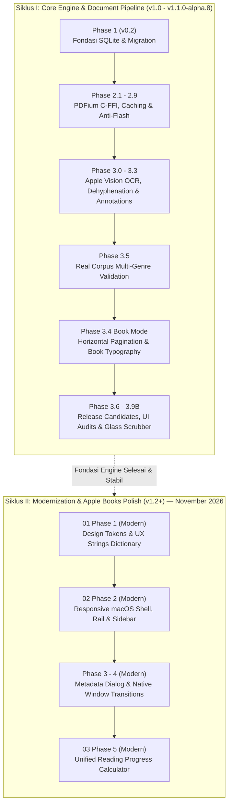

# Digital Books — Documentation Hub & Architecture Catalog

Selamat datang di direktori dokumentasi resmi **Digital Books**. Dokumen ini berfungsi sebagai peta navigasi utama, indeks arsitektur, dan katalog kronologis seluruh dokumen teknis, standar tata kelola (*governance*), spesifikasi sistem, serta laporan pengujian (*audit & benchmark reports*) proyek Digital Books.

---

## 1. Peta Jalan & Linimasa Dua Siklus (The Two-Cycle Evolution Roadmap)

Untuk memahami alur dan penomoran fase di Digital Books (mengapa terdapat **Phase 1, 2, dan 5 yang baru dikerjakan pada Siklus II**, sementara **Phase 3.0 s.d. 3.9B merupakan fase historis pada Siklus I**), perhatikan linimasa dua siklus rekayasa berikut:



### Penjelasan Dua Siklus Pengembangan:
1. **Siklus I — Core Engine & Document Pipeline (Fase Historis / v1.0 s.d. v1.1.0-alpha.8)**:
   - Dikerjakan selama fase perintisan arsitektur inti (Oktober – awal November 2026).
   - Fokus: Stabilitas rendering PDFium native, eliminasi *blank flash*, integrasi Apple Vision OCR lokal tanpa cloud, normalisasi paragraf, rekonsiliasi kata, pencarian semantik berkecepatan tinggi, paginasi horizontal Book Mode, dan rangkaian Release Candidate 3.6 s.d. 3.9B.
   - Lokasi berkas: [`docs/03 Reports/01 Historical Engine v1.1/`](file:///Users/davindalana/Documents/Project/Digital%20Books/docs/03%20Reports/01%20Historical%20Engine%20v1.1).
2. **Siklus II — Modernization & Apple Books Polish Initiative (Fase Terkini / v1.2+)**:
   - Berjalan aktif mulai **12 November 2026**.
   - Fokus: Peningkatan pengalaman desktop macOS asli (standar Apple Books), perancangan token desain (`AppThemeTokens`), tata letak adaptif 3 breakpoint (`compact < 700dp`, `standard 900dp`, `expansive >= 1280dp`), icon rail, sidebar native, kamus terminologi antarmuka terpusat (`AppStrings`), dan kalkulator progres membaca yang mode-aware (`ReadingProgressCalculator`).
   - Lokasi berkas: [`docs/03 Reports/02 Modernization v1.2/`](file:///Users/davindalana/Documents/Project/Digital%20Books/docs/03%20Reports/02%20Modernization%20v1.2).

---

## 2. Struktur Direktori Dokumentasi Berurutan (Sequential Structure)

Seluruh nama folder dan berkas menggunakan **Title Case dengan spasi** dan mematuhi aturan penamaan baku:
- **Kategori Kebijakan Tata Kelola (`01 Governance/`)**: Menggunakan penamaan deskriptif murni dari awal hingga akhir.
- **Kategori Arsitektur & Laporan (`02 Architecture/` & `03 Reports/`)**: Menggunakan penamaan berbasis **Phase** secara konsisten hingga akhir, dilengkapi penjelasan isi yang jelas dan nomor urut dua digit (`01`, `02`, `03`...):

```text
docs/
├── README.md                                  # Katalog Utama & Peta Navigasi Sistem
├── 01 Governance/                             # Standar Tata Kelola & Rekayasa (Deskriptif Murni)
│   ├── 01 Development Workflow.md             # Siklus 13 Langkah Baku & Commit Policy
│   └── 02 Versioning Policy.md                # Spesifikasi SemVer 2.0.0 & Release Gates
├── 02 Architecture/                           # Cetak Biru Arsitektur (Berbasis Phase)
│   ├── 01 Phase 3.0 Scanned PDF Intelligence Architecture.md
│   ├── 02 Phase 3.1 Local-First Background OCR Architecture.md
│   ├── 03 Phase 3.4 Complete Reading Experience Overhaul.md
│   └── 04 Phase 3.4 Book Mode Finalization Roadmap.md
├── 03 Reports/                                # Seluruh Laporan Validasi & Audit (Berbasis Phase)
│   ├── 01 Historical Engine v1.1/             # [SIKLUS I — HISTORIS] Pipeline Mesin Inti
│   │   ├── 01 Phase 3.0 Core Engine/          # 13 Laporan Phase 3.0, 3.0.1, 3.0.1.1
│   │   ├── 02 Phase 3.1 Apple Vision OCR/     # 3 Laporan Apple Vision OCR
│   │   ├── 03 Phase 3.2 In-Book Search/       # 2 Laporan In-Book Search & Traversal
│   │   ├── 04 Phase 3.3 Annotations/          # 1 Laporan Anotasi, Sorotan & Catatan
│   │   ├── 05 Phase 3.5 Real Corpus Validation/ # 4 Laporan Validasi Korpus Riil & Audit
│   │   ├── 06 Phase 3.4 Book Mode/            # 5 Laporan Redesain Paginasi & Layout Buku
│   │   └── 07 Phase 3.6 to 3.9B Release Candidates/ # 8 Laporan Release Candidate & UI Audits
│   └── 02 Modernization v1.2/                 # [SIKLUS II — TERKINI] Modernisasi UI/UX macOS
│       ├── 01 Phase 1 Design Tokens and UX Strings.md
│       ├── 02 Phase 2 macOS Responsive Shell and Sidebar.md
│       └── 03 Phase 5 Reading Progress Calculator.md
└── visual_evidence/                           # Artefak Visual Tangkapan Layar Native macOS
```

---

## 3. Standar Tata Kelola Rekayasa (`01 Governance/`)

> [!NOTE]
> Kategori ini memuat standar operasional, aturan git, dan tata kelola rilis yang bersifat **deskriptif murni** dan berlaku permanen untuk seluruh fase pengembangan.

| Nomor | Dokumen | Deskripsi & Isi Utama | Tautan |
| :---: | :--- | :--- | :--- |
| **01** | **Development Workflow** | 13 langkah siklus pengembangan baku, Conventional Commits, aturan `CHANGELOG.md`, prosedur regression test, mitigasi rollback, dan proteksi integritas data. | [`01 Development Workflow.md`](file:///Users/davindalana/Documents/Project/Digital%20Books/docs/01%20Governance/01%20Development%20Workflow.md) |
| **02** | **Versioning Policy** | Skema SemVer 2.0.0 (`MAJOR.MINOR.PATCH-PRERELEASE+BUILD`), tahapan siklus rilis (Alpha, Beta, RC, Stable), dan aturan kenaikan nomor rilis. | [`02 Versioning Policy.md`](file:///Users/davindalana/Documents/Project/Digital%20Books/docs/01%20Governance/02%20Versioning%20Policy.md) |

---

## 4. Cetak Biru Arsitektur Sistem (`02 Architecture/`)

> [!NOTE]
> Seluruh dokumen cetak biru arsitektur menggunakan penamaan berbasis **Phase** secara konsisten hingga akhir untuk menandai fase target spesifikasinya.

| Nomor | Dokumen | Deskripsi & Cakupan | Tautan |
| :---: | :--- | :--- | :--- |
| **01** | **Phase 3.0 Scanned PDF Intelligence Architecture** | Spesifikasi Dual-Engine Reading System (Original PDFium C-FFI vs Reflowable TextPainter), layer caching bitmap dua tingkat, dan state management Riverpod. | [`01 Phase 3.0 Scanned PDF Intelligence Architecture.md`](file:///Users/davindalana/Documents/Project/Digital%20Books/docs/02%20Architecture/01%20Phase%203.0%20Scanned%20PDF%20Intelligence%20Architecture.md) |
| **02** | **Phase 3.1 Local-First Background OCR Architecture** | Arsitektur pipeline pemrosesan dokumen lokal: Image Enhancement LUT, Apple Vision OCR, dehyphenation bahasa Indonesia, dan Semantic Reconstruction. | [`02 Phase 3.1 Local-First Background OCR Architecture.md`](file:///Users/davindalana/Documents/Project/Digital%20Books/docs/02%20Architecture/02%20Phase%203.1%20Local-First%20Background%20OCR%20Architecture.md) |
| **03** | **Phase 3.4 Complete Reading Experience Overhaul** | Cetak biru perombakan total pengalaman membaca: estetika tipografi Apple Books, mode bentang halaman (single/two-page spread), dan fluid navigation. | [`03 Phase 3.4 Complete Reading Experience Overhaul.md`](file:///Users/davindalana/Documents/Project/Digital%20Books/docs/02%20Architecture/03%20Phase%203.4%20Complete%20Reading%20Experience%20Overhaul.md) |
| **04** | **Phase 3.4 Book Mode Finalization Roadmap** | Peta jalan penyelesaian Book Mode: paginasi horizontal presisi kata, pembatasan orphan/widow, kalkulasi waktu tersisa bab, dan rendering spread adaptif. | [`04 Phase 3.4 Book Mode Finalization Roadmap.md`](file:///Users/davindalana/Documents/Project/Digital%20Books/docs/02%20Architecture/04%20Phase%203.4%20Book%20Mode%20Finalization%20Roadmap.md) |

---

## 5. Laporan Siklus I — Core Engine & Pipeline Historis v1.1 (`03 Reports/01 Historical Engine v1.1/`)

### 5.1 Sub-Fase 3.0 & 3.0.1 (`01 Phase 3.0 Core Engine/`)

| No | Dokumen | Kategori | Ringkasan Isi | Tautan |
| :---: | :--- | :--- | :--- | :--- |
| **01** | `01 Phase 3.0 Scanned PDF Intelligence Benchmark.md` | Benchmark | Pengukuran baseline performa render PDFium, alokasi memori, dan efisiensi paginasi awal. | [`Buka`](file:///Users/davindalana/Documents/Project/Digital%20Books/docs/03%20Reports/01%20Historical%20Engine%20v1.1/01%20Phase%203.0%20Core%20Engine/01%20Phase%203.0%20Scanned%20PDF%20Intelligence%20Benchmark.md) |
| **02** | `02 Phase 3.0.1 Image Enhancement Implementation.md` | Milestone | Implementasi stabilisasi cache bitmap ganda, eliminasi double white flash, dan unblocking gesture. | [`Buka`](file:///Users/davindalana/Documents/Project/Digital%20Books/docs/03%20Reports/01%20Historical%20Engine%20v1.1/01%20Phase%203.0%20Core%20Engine/02%20Phase%203.0.1%20Image%20Enhancement%20Implementation.md) |
| **03** | `03 Phase 3.0.1 Performance and Latency Benchmark.md` | Benchmark | Tolok ukur latensi perpindahan halaman dan konsumsi RAM pasca perbaikan cache. | [`Buka`](file:///Users/davindalana/Documents/Project/Digital%20Books/docs/03%20Reports/01%20Historical%20Engine%20v1.1/01%20Phase%203.0%20Core%20Engine/03%20Phase%203.0.1%20Performance%20and%20Latency%20Benchmark.md) |
| **04** | `04 Phase 3.0.1 Reader Quality and Contrast.md` | Quality | Evaluasi kualitas keterbacaan, pemilihan font macOS native, dan kontras warna pada 4 palet membaca. | [`Buka`](file:///Users/davindalana/Documents/Project/Digital%20Books/docs/03%20Reports/01%20Historical%20Engine%20v1.1/01%20Phase%203.0%20Core%20Engine/04%20Phase%203.0.1%20Reader%20Quality%20and%20Contrast.md) |
| **05** | `05 Phase 3.0.1 Reflowable Semantic Reconstruction.md` | Engine | Validasi normalisasi paragraf, deteksi heading bab (H1–H3), dan penanganan tanda hubung kata ulang. | [`Buka`](file:///Users/davindalana/Documents/Project/Digital%20Books/docs/03%20Reports/01%20Historical%20Engine%20v1.1/01%20Phase%203.0%20Core%20Engine/05%20Phase%203.0.1%20Reflowable%20Semantic%20Reconstruction.md) |
| **06** | `06 Phase 3.0.1 PDF Transition and Anti Flash Validation.md` | Validation | Uji transisi kurva kubik pada perpindahan halaman PDF ganda tanpa frame drop. | [`Buka`](file:///Users/davindalana/Documents/Project/Digital%20Books/docs/03%20Reports/01%20Historical%20Engine%20v1.1/01%20Phase%203.0%20Core%20Engine/06%20Phase%203.0.1%20PDF%20Transition%20and%20Anti%20Flash%20Validation.md) |
| **07** | `07 Phase 3.0.1 Comprehensive Regression Benchmark.md` | Perf | Profiling CPU dan raster thread selama navigasi cepat 60 FPS pada monitor Retina. | [`Buka`](file:///Users/davindalana/Documents/Project/Digital%20Books/docs/03%20Reports/01%20Historical%20Engine%20v1.1/01%20Phase%203.0%20Core%20Engine/07%20Phase%203.0.1%20Comprehensive%20Regression%20Benchmark.md) |
| **08** | `08 Phase 3.0.1 Visual Layout Evidence.md` | Visual | Bukti tangkapan layar transisi halaman, rendering halaman ganda, dan visual palet tema. | [`Buka`](file:///Users/davindalana/Documents/Project/Digital%20Books/docs/03%20Reports/01%20Historical%20Engine%20v1.1/01%20Phase%203.0%20Core%20Engine/08%20Phase%203.0.1%20Visual%20Layout%20Evidence.md) |
| **09** | `09 Phase 3.0.1 Final Product Acceptance Report.md` | Acceptance | Laporan kelayakan rilis checkpoint Phase 3.0.1 dengan 240/240 automated test passing. | [`Buka`](file:///Users/davindalana/Documents/Project/Digital%20Books/docs/03%20Reports/01%20Historical%20Engine%20v1.1/01%20Phase%203.0%20Core%20Engine/09%20Phase%203.0.1%20Final%20Product%20Acceptance%20Report.md) |
| **10** | `10 Phase 3.0.1.1 Tone Mapping Enhancement Fix.md` | Fix | Perbaikan algoritma tone-mapping S-curve LUT untuk dokumen pindaian fotokopi kontras rendah. | [`Buka`](file:///Users/davindalana/Documents/Project/Digital%20Books/docs/03%20Reports/01%20Historical%20Engine%20v1.1/01%20Phase%203.0%20Core%20Engine/10%20Phase%203.0.1.1%20Tone%20Mapping%20Enhancement%20Fix.md) |
| **11** | `11 Phase 3.0.1.1 Gutter Crease Shadow Validation.md` | Validation | Validasi flattening kelengkungan gutter (punggung buku) pada buku pindaian tebal. | [`Buka`](file:///Users/davindalana/Documents/Project/Digital%20Books/docs/03%20Reports/01%20Historical%20Engine%20v1.1/01%20Phase%203.0%20Core%20Engine/11%20Phase%203.0.1.1%20Gutter%20Crease%20Shadow%20Validation.md) |
| **12** | `12 Phase 3.0.1.1 Native 3D Curl Transition Validation.md` | Validation | Validasi efek curl 3D native macOS dan retensi permukaan halaman selama animasi buka buku. | [`Buka`](file:///Users/davindalana/Documents/Project/Digital%20Books/docs/03%20Reports/01%20Historical%20Engine%20v1.1/01%20Phase%203.0%20Core%20Engine/12%20Phase%203.0.1.1%20Native%203D%20Curl%20Transition%20Validation.md) |
| **13** | `13 Phase 3.0.1.1 High Frequency Performance Benchmark.md` | Perf | Pengukuran latensi enhancement LUT (18 ms per halaman 8.1 MB) di bawah anggaran 35 ms. | [`Buka`](file:///Users/davindalana/Documents/Project/Digital%20Books/docs/03%20Reports/01%20Historical%20Engine%20v1.1/01%20Phase%203.0%20Core%20Engine/13%20Phase%203.0.1.1%20High%20Frequency%20Performance%20Benchmark.md) |

---

### 5.2 Sub-Fase 3.1 Apple Vision OCR (`02 Phase 3.1 Apple Vision OCR/`)

| No | Dokumen | Kategori | Ringkasan Isi | Tautan |
| :---: | :--- | :--- | :--- | :--- |
| **01** | `01 Phase 3.1 OCR Engine Acceptance.md` | Acceptance | Integrasi Apple Vision OCR lokal pada macOS tanpa cloud API. | [`Buka`](file:///Users/davindalana/Documents/Project/Digital%20Books/docs/03%20Reports/01%20Historical%20Engine%20v1.1/02%20Phase%203.1%20Apple%20Vision%20OCR/01%20Phase%203.1%20OCR%20Engine%20Acceptance.md) |
| **02** | `02 Phase 3.1.1 Full Book Multi Chapter Acceptance.md` | Acceptance | Uji ekstraksi dan rekonstruksi semantik buku utuh multi-bab. | [`Buka`](file:///Users/davindalana/Documents/Project/Digital%20Books/docs/03%20Reports/01%20Historical%20Engine%20v1.1/02%20Phase%203.1%20Apple%20Vision%20OCR/02%20Phase%203.1.1%20Full%20Book%20Multi%20Chapter%20Acceptance.md) |
| **03** | `03 Phase 3.1.2 Full Book Reflowable Reading Quality.md` | Quality | Audit tipografi, keterbacaan paragraf terjustifikasi, dan preservasi dialog. | [`Buka`](file:///Users/davindalana/Documents/Project/Digital%20Books/docs/03%20Reports/01%20Historical%20Engine%20v1.1/02%20Phase%203.1%20Apple%20Vision%20OCR/03%20Phase%203.1.2%20Full%20Book%20Reflowable%20Reading%20Quality.md) |

---

### 5.3 Sub-Fase 3.2 s.d. 3.5 (`03 Phase 3.2`, `04 Phase 3.3`, `05 Phase 3.5`)

| No | Folder & Dokumen | Kategori | Ringkasan Isi | Tautan |
| :---: | :--- | :--- | :--- | :--- |
| **01** | `03 Phase 3.2 .../01 Phase 3.2 In Book Full Text Search.md` | Feature | Integrasi in-book search pada struktur semantik terekonstruksi. | [`Buka`](file:///Users/davindalana/Documents/Project/Digital%20Books/docs/03%20Reports/01%20Historical%20Engine%20v1.1/03%20Phase%203.2%20In-Book%20Search/01%20Phase%203.2%20In%20Book%20Full%20Text%20Search.md) |
| **02** | `03 Phase 3.2 .../02 Phase 3.2.1 Search Accuracy and Traversal Audit.md` | Audit | Audit akurasi fuzzy match, bounding box PDF, dan navigasi siklis. | [`Buka`](file:///Users/davindalana/Documents/Project/Digital%20Books/docs/03%20Reports/01%20Historical%20Engine%20v1.1/03%20Phase%203.2%20In-Book%20Search/02%20Phase%203.2.1%20Search%20Accuracy%20and%20Traversal%20Audit.md) |
| **03** | `04 Phase 3.3 .../01 Phase 3.3 Annotations and Highlights Subsystem.md` | Milestone | Text selection toolbar, palet sorotan 6-warna, dan panel catatan. | [`Buka`](file:///Users/davindalana/Documents/Project/Digital%20Books/docs/03%20Reports/01%20Historical%20Engine%20v1.1/04%20Phase%203.3%20Annotations/01%20Phase%203.3%20Annotations%20and%20Highlights%20Subsystem.md) |
| **04** | `05 Phase 3.5 .../01 Phase 3.5 Real World Corpus Validation.md` | Validation | Evaluasi performa OCR pada 7 kategori korpus buku riil. | [`Buka`](file:///Users/davindalana/Documents/Project/Digital%20Books/docs/03%20Reports/01%20Historical%20Engine%20v1.1/05%20Phase%203.5%20Real%20Corpus%20Validation/01%20Phase%203.5%20Real%20World%20Corpus%20Validation.md) |
| **05** | `05 Phase 3.5 .../02 Phase 3.5.1 Independent Adversarial Audit.md` | Audit | Audit independen: temuan dehyphenation (CRIT-01) dan metrik (CRIT-02). | [`Buka`](file:///Users/davindalana/Documents/Project/Digital%20Books/docs/03%20Reports/01%20Historical%20Engine%20v1.1/05%20Phase%203.5%20Real%20Corpus%20Validation/02%20Phase%203.5.1%20Independent%20Adversarial%20Audit.md) |
| **06** | `05 Phase 3.5 .../03 Phase 3.5.2 Audit Remediation Verification.md` | Verification | Verifikasi penyelesaian temuan audit dengan tabel leksem tertutup. | [`Buka`](file:///Users/davindalana/Documents/Project/Digital%20Books/docs/03%20Reports/01%20Historical%20Engine%20v1.1/05%20Phase%203.5%20Real%20Corpus%20Validation/03%20Phase%203.5.2%20Audit%20Remediation%20Verification.md) |
| **07** | `05 Phase 3.5 .../04 Phase 3.5.3 Native macOS E2E Validation.md` | E2E | Uji kestabilan memori native dan penjelajahan dokumen panjang. | [`Buka`](file:///Users/davindalana/Documents/Project/Digital%20Books/docs/03%20Reports/01%20Historical%20Engine%20v1.1/05%20Phase%203.5%20Real%20Corpus%20Validation/04%20Phase%203.5.3%20Native%20macOS%20E2E%20Validation.md) |

---

### 5.4 Sub-Fase 3.4 Book Mode Redesign (`06 Phase 3.4 Book Mode/`)

| No | Dokumen | Kategori | Ringkasan Isi | Tautan |
| :---: | :--- | :--- | :--- | :--- |
| **01** | `01 Phase 3.4 Book Mode Horizontal Pagination Report.md` | Milestone | Paginasi horizontal kolom ganda dan resolusi anchor kata presisi. | [`Buka`](file:///Users/davindalana/Documents/Project/Digital%20Books/docs/03%20Reports/01%20Historical%20Engine%20v1.1/06%20Phase%203.4%20Book%20Mode/01%20Phase%203.4%20Book%20Mode%20Horizontal%20Pagination%20Report.md) |
| **02** | `02 Phase 3.4 Book Mode Reading Experience Redesign Report.md` | Redesign | Redesain Book Mode bergaya buku cetak mewah (margin, drop cap, TOC leaders). | [`Buka`](file:///Users/davindalana/Documents/Project/Digital%20Books/docs/03%20Reports/01%20Historical%20Engine%20v1.1/06%20Phase%203.4%20Book%20Mode/02%20Phase%203.4%20Book%20Mode%20Reading%20Experience%20Redesign%20Report.md) |
| **03** | `03 Phase 3.4 Real Book Visual Acceptance Report.md` | Acceptance | Uji visual buku riil bahasa Indonesia (Bab I–V, halaman legal). | [`Buka`](file:///Users/davindalana/Documents/Project/Digital%20Books/docs/03%20Reports/01%20Historical%20Engine%20v1.1/06%20Phase%203.4%20Book%20Mode/03%20Phase%203.4%20Real%20Book%20Visual%20Acceptance%20Report.md) |
| **04** | `04 Phase 3.4 Final Product Acceptance Report.md` | Acceptance | Evaluasi kesiapan produk menyeluruh lintas mode membaca dan tema. | [`Buka`](file:///Users/davindalana/Documents/Project/Digital%20Books/docs/03%20Reports/01%20Historical%20Engine%20v1.1/06%20Phase%203.4%20Book%20Mode/04%20Phase%203.4%20Final%20Product%20Acceptance%20Report.md) |
| **05** | `05 Phase 3.4 Final Release Readiness Report.md` | Release | Pemeriksaan checklist akhir sebelum pembuatan Release Candidate. | [`Buka`](file:///Users/davindalana/Documents/Project/Digital%20Books/docs/03%20Reports/01%20Historical%20Engine%20v1.1/06%20Phase%203.4%20Book%20Mode/05%20Phase%203.4%20Final%20Release%20Readiness%20Report.md) |

---

### 5.5 Sub-Fase 3.6 s.d. 3.9B Release Candidates (`07 Phase 3.6 to 3.9B Release Candidates/`)

| No | Dokumen | Kategori | Ringkasan Isi | Tautan |
| :---: | :--- | :--- | :--- | :--- |
| **01** | `01 Phase 3.6 Release Candidate Report.md` | Release Candidate | Laporan Release Candidate Phase 3.6 dengan uji multi-buku 1.238 halaman. | [`Buka`](file:///Users/davindalana/Documents/Project/Digital%20Books/docs/03%20Reports/01%20Historical%20Engine%20v1.1/07%20Phase%203.6%20to%203.9B%20Release%20Candidates/01%20Phase%203.6%20Release%20Candidate%20Report.md) |
| **02** | `02 Phase 3.7 Independent Audit Report.md` | Audit | Audit verifikasi independen atas metrik evaluasi buku dan pemurnian test suite Phase 3.6. | [`Buka`](file:///Users/davindalana/Documents/Project/Digital%20Books/docs/03%20Reports/01%20Historical%20Engine%20v1.1/07%20Phase%203.6%20to%203.9B%20Release%20Candidates/02%20Phase%203.7%20Independent%20Audit%20Report.md) |
| **03** | `03 Phase 3.8 Artifact Integrity Report.md` | Integrity | Uji integritas backup, restore, dan relink PDF pada format bundle mandiri. | [`Buka`](file:///Users/davindalana/Documents/Project/Digital%20Books/docs/03%20Reports/01%20Historical%20Engine%20v1.1/07%20Phase%203.6%20to%203.9B%20Release%20Candidates/03%20Phase%203.8%20Artifact%20Integrity%20Report.md) |
| **04** | `04 Phase 3.9A Scanned OCR Pilot Report.md` | Pilot | Uji percontohan throughput pemrosesan background OCR berbasis Apple Vision pada macOS. | [`Buka`](file:///Users/davindalana/Documents/Project/Digital%20Books/docs/03%20Reports/01%20Historical%20Engine%20v1.1/07%20Phase%203.6%20to%203.9B%20Release%20Candidates/04%20Phase%203.9A%20Scanned%20OCR%20Pilot%20Report.md) |
| **05** | `05 Phase 3.9A Reader UI Consistency Audit.md` | UI Audit | Audit ergonomi UI layar pembaca, hierarchy tombol, dan konsistensi status bar. | [`Buka`](file:///Users/davindalana/Documents/Project/Digital%20Books/docs/03%20Reports/01%20Historical%20Engine%20v1.1/07%20Phase%203.6%20to%203.9B%20Release%20Candidates/05%20Phase%203.9A%20Reader%20UI%20Consistency%20Audit.md) |
| **06** | `06 Phase 3.9B Minimalist Reader UI Audit.md` | UI Design | Implementasi antarmuka baca minimalis dengan auto-hide bar atas dan indikator hover tepi. | [`Buka`](file:///Users/davindalana/Documents/Project/Digital%20Books/docs/03%20Reports/01%20Historical%20Engine%20v1.1/07%20Phase%203.6%20to%203.9B%20Release%20Candidates/06%20Phase%203.9B%20Minimalist%20Reader%20UI%20Audit.md) |
| **07** | `07 Phase 3.9B Reader Typography Refinement Report.md` | Typography | Pemurnian tipografi, pengaturan spasi baris, dan penyesuaian font multi-resolusi. | [`Buka`](file:///Users/davindalana/Documents/Project/Digital%20Books/docs/03%20Reports/01%20Historical%20Engine%20v1.1/07%20Phase%203.6%20to%203.9B%20Release%20Candidates/07%20Phase%203.9B%20Reader%20Typography%20Refinement%20Report.md) |
| **08** | `08 Phase 3.9B Reader UI Alignment and Glass Progress Scrubber.md` | UI Design | Penyesuaian alignment top bar, glass-effect progress scrubber, dan konsistensi inset antar panel. | [`Buka`](file:///Users/davindalana/Documents/Project/Digital%20Books/docs/03%20Reports/01%20Historical%20Engine%20v1.1/07%20Phase%203.6%20to%203.9B%20Release%20Candidates/08%20Phase%203.9B%20Reader%20UI%20Alignment%20and%20Glass%20Progress%20Scrubber.md) |

---

## 6. Laporan Siklus II — Modernisasi UI/UX v1.2+ (`03 Reports/02 Modernization v1.2/`)

> [!NOTE]
> Ini adalah rangkaian inisiatif modernisasi antarmuka dan pengalaman pengguna desktop macOS yang aktif dikembangkan pada **November 2026**.

| No | Dokumen | Topik & Cakupan | Tautan |
| :---: | :--- | :--- | :--- |
| **01** | `01 Phase 1 Design Tokens and UX Strings.md` | Sentralisasi skala spasi (`AppThemeTokens`), skala radius, konstanta breakpoint macOS, dan kamus terminologi UX terpadu (`AppStrings`). | [`Buka`](file:///Users/davindalana/Documents/Project/Digital%20Books/docs/03%20Reports/02%20Modernization%20v1.2/01%20Phase%201%20Design%20Tokens%20and%20UX%20Strings.md) |
| **02** | `02 Phase 2 macOS Responsive Shell and Sidebar.md` | Shell adaptif desktop macOS dengan 3 breakpoint (`compact < 700dp`, `standard 900dp`, `expansive >= 1280dp`), Icon Rail ramping ($64\text{ dp}$), Native Sidebar ($220\text{ dp}$), dan sinkronisasi rak buku aktif. | [`Buka`](file:///Users/davindalana/Documents/Project/Digital%20Books/docs/03%20Reports/02%20Modernization%20v1.2/02%20Phase%202%20macOS%20Responsive%20Shell%20and%20Sidebar.md) |
| **03** | `03 Phase 5 Reading Progress Calculator.md` | Kalkulator progres membaca mode-aware (`ReadingProgressCalculator`), pemisahan metrik fisik (PDF) vs semantik (Book Mode), dan estimasi waktu baca per bab. | [`Buka`](file:///Users/davindalana/Documents/Project/Digital%20Books/docs/03%20Reports/02%20Modernization%20v1.2/03%20Phase%205%20Reading%20Progress%20Calculator.md) |

---

## 7. Bukti Visual Pengujian Native macOS (`docs/visual_evidence/`)

> [!NOTE]
> Seluruh artefak tangkapan layar beresolusi tinggi (lossless Retina DPR $2.0\times$) disimpan dan diindeks secara komprehensif pada direktori [`docs/visual_evidence/`](file:///Users/davindalana/Documents/Project/Digital%20Books/docs/visual_evidence). Untuk panduan lengkap, diagram alur pemrosesan, dan inventaris detail 18 subdirektori, buka [Katalog Bukti Visual & Alur Verifikasi Native macOS](file:///Users/davindalana/Documents/Project/Digital%20Books/docs/visual_evidence/README.md).

> [!IMPORTANT]
> **Dilarang memindahkan atau mengubah nama direktori di dalam `docs/visual_evidence/`!**
> Direktori ini diakses dan ditulis secara langsung oleh rangkaian tes otomatis (`test/*_test.dart`) dan alat native Swift (`tools/capture_native_windows.swift`) untuk memverifikasi regresi visual tata letak macOS.

| No | Alur Fungsional Bukti Visual | Subdirektori Artefak | Siklus & Fase | Cakupan Verifikasi Utama | Dokumen Panduan |
| :---: | :--- | :--- | :---: | :--- | :--- |
| **01** | **Prapemrosesan & Peningkatan Citra** | [`scan_enhancement/`](file:///Users/davindalana/Documents/Project/Digital%20Books/docs/visual_evidence/scan_enhancement)<br/>[`enhancement_fix/`](file:///Users/davindalana/Documents/Project/Digital%20Books/docs/visual_evidence/enhancement_fix) | Siklus I<br/>Phase 3.0.1 / 3.0.1.1 | Peningkatan kontras kertas kuning, penajaman tepi huruf via unsharp mask, dan preservasi tanda baca tipis. | [`Buka`](file:///Users/davindalana/Documents/Project/Digital%20Books/docs/visual_evidence/README.md#alur-1-prapemrosesan--peningkatan-citra-pindaian-image-enhancement--tone-mapping) |
| **02** | **Transisi Halaman & 3D Curl Native** | [`transitions/`](file:///Users/davindalana/Documents/Project/Digital%20Books/docs/visual_evidence/transitions)<br/>[`native_transitions/`](file:///Users/davindalana/Documents/Project/Digital%20Books/docs/visual_evidence/native_transitions) | Siklus I<br/>Phase 3.0.1 / 3.0.1.1 | Eliminasi *white flash* pada spread rendering PDFium dan kurva kubik transisi curl 3D native 340 ms. | [`Buka`](file:///Users/davindalana/Documents/Project/Digital%20Books/docs/visual_evidence/README.md#alur-2-transisi-halaman--efek-3d-curl-native-page-transitions--3d-curl) |
| **03** | **Apple Vision OCR & Tipografi Reflowable** | [`phase_3_1_1/`](file:///Users/davindalana/Documents/Project/Digital%20Books/docs/visual_evidence/phase_3_1_1)<br/>[`phase_3_1_2/`](file:///Users/davindalana/Documents/Project/Digital%20Books/docs/visual_evidence/phase_3_1_2)<br/>[`reflowable/`](file:///Users/davindalana/Documents/Project/Digital%20Books/docs/visual_evidence/reflowable) | Siklus I<br/>Phase 3.1 s.d. 3.1.2 | Perbandingan scan asli vs reflowable, teks terjustifikasi, skala font (14–24pt), tema (Terang, Sepia, Gelap), dan mode baca. | [`Buka`](file:///Users/davindalana/Documents/Project/Digital%20Books/docs/visual_evidence/README.md#alur-3-apple-vision-ocr--rekonstruksi-tipografi-reflowable-ocr--typography-quality) |
| **04** | **Pencarian Penuh Dalam Buku (In-Book)** | [`phase_3_2/`](file:///Users/davindalana/Documents/Project/Digital%20Books/docs/visual_evidence/phase_3_2)<br/>[`phase_3_2_1/`](file:///Users/davindalana/Documents/Project/Digital%20Books/docs/visual_evidence/phase_3_2_1) | Siklus I<br/>Phase 3.2 / 3.2.1 | Dialog pencarian semantik, precision bounding-box emas, traversal bar, navigasi siklis, dan retensi match saat resize. | [`Buka`](file:///Users/davindalana/Documents/Project/Digital%20Books/docs/visual_evidence/README.md#alur-4-pencarian-penuh-dalam-buku-in-book-search--precision-traversal) |
| **05** | **Anotasi, Sorotan & Catatan Pengguna** | [`phase_3_3/`](file:///Users/davindalana/Documents/Project/Digital%20Books/docs/visual_evidence/phase_3_3) | Siklus I<br/>Phase 3.3 | Selection toolbar, palet 6 warna, bottom sheet catatan, bookmark toggle, perpustakaan anotasi, dan jump navigation. | [`Buka`](file:///Users/davindalana/Documents/Project/Digital%20Books/docs/visual_evidence/README.md#alur-5-anotasi-sorotan-warna--catatan-pengguna-annotations--highlights-subsystem) |
| **06** | **Validasi Korpus Riil Multi-Genre** | [`phase_3_5/`](file:///Users/davindalana/Documents/Project/Digital%20Books/docs/visual_evidence/phase_3_5) | Siklus I<br/>Phase 3.5 | Evaluasi performa OCR dan dehyphenation pada 7 korpus buku riil (*Laut Bercerita*, *Bicara Itu Ada Seninya*, dll.). | [`Buka`](file:///Users/davindalana/Documents/Project/Digital%20Books/docs/visual_evidence/README.md#alur-6-validasi-korpus-riil-multi-genre-real-world-multi-corpus-validation) |
| **07** | **Book Mode & Akseptansi Buku Utuh** | [`book_mode_acceptance/`](file:///Users/davindalana/Documents/Project/Digital%20Books/docs/visual_evidence/book_mode_acceptance)<br/>[`book_mode_redesign/`](file:///Users/davindalana/Documents/Project/Digital%20Books/docs/visual_evidence/book_mode_redesign)<br/>[`phase_3_6/`](file:///Users/davindalana/Documents/Project/Digital%20Books/docs/visual_evidence/phase_3_6)<br/>[`real_book_acceptance/`](file:///Users/davindalana/Documents/Project/Digital%20Books/docs/visual_evidence/real_book_acceptance) | Siklus I<br/>Phase 3.4 / 3.6 | Paginasi horizontal Bab I–V, estetika buku cetak (drop cap, TOC leaders), resolusi black screen bug, dan uji buku riil 255 halaman. | [`Buka`](file:///Users/davindalana/Documents/Project/Digital%20Books/docs/visual_evidence/README.md#alur-7-book-mode--akseptansi-buku-utuh-book-mode-pagination--real-book-acceptance) |
| **08** | **Antarmuka Minimalis Layar Baca** | [`minimalist_ui/`](file:///Users/davindalana/Documents/Project/Digital%20Books/docs/visual_evidence/minimalist_ui) | Siklus I & II<br/>Phase 3.9B / v1.2 | Auto-hide toolbar, hover edge triggers, tema, pemotongan judul panjang, traffic lights band macOS, dan running title centering. | [`Buka`](file:///Users/davindalana/Documents/Project/Digital%20Books/docs/visual_evidence/README.md#alur-8-antarmuka-minimalis-layar-baca-minimalist-reader-ui--traffic-lights) |
| **09** | **Shell Desktop macOS Responsif** | [`phase_2_shell/`](file:///Users/davindalana/Documents/Project/Digital%20Books/docs/visual_evidence/phase_2_shell)<br/>[`phase_2_native/`](file:///Users/davindalana/Documents/Project/Digital%20Books/docs/visual_evidence/phase_2_native) | Siklus II<br/>Phase 2 | Tata letak responsif 3 breakpoint (Compact 700dp, Standard 900dp, Expansive 1280dp) dan capture native macOS aktual tanpa modal dialog. | [`Buka`](file:///Users/davindalana/Documents/Project/Digital%20Books/docs/visual_evidence/README.md#alur-9-shell-desktop-macos-responsif--multi-breakpoint-layout-siklus-ii-modernization) |

---

## 8. Pedoman Penulisan Dokumentasi Baru

Setiap penambahan dokumen baru wajib mengikuti konvensi baku:

1. **Format Penamaan Berkas & Folder**:
   - Jika dokumen merupakan **kebijakan atau tata kelola umum**, gunakan format deskriptif murni (contoh: `03 Data Retention Policy.md`).
   - Jika dokumen merupakan **laporan fase atau cetak biru teknis**, gunakan awalan nomor urut dua digit diikuti oleh `Phase [Nomor Fase] [Judul Deskriptif]` secara konsisten hingga akhir (contoh: `04 Phase 4 Native Window Transitions Report.md`).
2. **Penentuan Lokasi Folder**:
   - Standar Tata Kelola $\to$ `docs/01 Governance/`
   - Spesifikasi Arsitektur / Blueprint $\to$ `docs/02 Architecture/`
   - Laporan Pipeline Mesin Historis (v1.1) $\to$ `docs/03 Reports/01 Historical Engine v1.1/`
   - Laporan Inisiatif Modernisasi (v1.2+) $\to$ `docs/03 Reports/02 Modernization v1.2/`
   - Screenshot Uji Coba $\to$ `docs/visual_evidence/<kategori>/`
3. **Format Metadata Dokumen**:
   Sertakan blok metadata pada awal setiap laporan:
   ```markdown
   # Judul Dokumen

   > **Metadata Dokumen**
   > - **Siklus / Inisiatif**: Siklus II — Modernization & Apple Books Polish (v1.2+)
   > - **Modul / Kategori**: Phase X (...)
   > - **Urutan Dokumen**: 0X Phase X ...
   > - **Tanggal**: DD MMMM YYYY
   > - **Status Verifikasi**: PASS / CONDITIONAL PASS / FAIL
   ```
4. **Pencatatan ke Indeks**:
   - Daftarkan dokumen baru ke tabel yang relevan di dalam `docs/README.md`.
