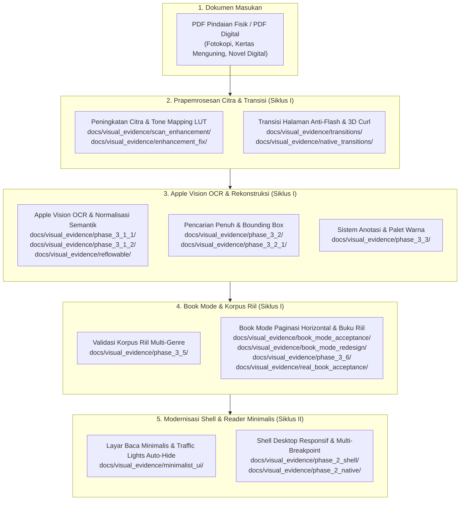

# Katalog Bukti Visual & Alur Verifikasi Native macOS (Visual Evidence)

> **Metadata Dokumen**
> - **Siklus / Inisiatif**: Siklus I (Core Engine v1.0–v1.1) & Siklus II (Modernization v1.2+)
> - **Modul / Kategori**: Bukti Visual Pengujian Native macOS & Regresi Layout
> - **Lokasi Direktori**: `docs/visual_evidence/`
> - **Status Verifikasi**: **PASS** (Tervalidasi pada Apple Retina Display $2.0\times$ DPR)
> - **Pemeliharaan**: Dikelola secara otomatis oleh test suite (`test/*_test.dart`) & alat native (`tools/capture_native_windows.swift`)

---

## 1. Pendahuluan & Prinsip Bukti Visual

Sesuai mandat pengembangan pada [AGENTS.md](file:///Users/davindalana/Documents/Project/Digital%20Books/AGENTS.md#L1-L49), pengujian antarmuka dan kenyamanan membaca Digital Books **tidak boleh hanya diasumsikan dari kelulusan unit test**, melainkan wajib diverifikasi secara visual pada aplikasi native macOS nyata.

Direktori `docs/visual_evidence/` menampung seluruh rekaman visual beresolusi tinggi (lossless PNG) yang dihasilkan selama proses pengembangan dua siklus rekayasa:
1. **Siklus I (Core Engine & Document Pipeline v1.0 s.d. v1.1)**: Menjamin eliminasi *white flash*, prapemrosesan pindaian kontras tinggi, ekstraksi teks lokal Apple Vision OCR, tipografi buku cetak Book Mode, pencarian semantik berkecepatan tinggi, dan sistem anotasi.
2. **Siklus II (Modernization & Apple Books Polish v1.2+)**: Menjamin responsivitas tata letak shell macOS pada tiga breakpoint (`compact < 700dp`, `standard 900dp`, `expansive >= 1280dp`), auto-hide toolbar dan sinkronisasi traffic light macOS, serta keselarasan tata letak reader minimalis.

---

## 2. Alur Verifikasi Bukti Visual (Visual Verification Pipeline)

Alur verifikasi bukti visual mengikuti siklus pemrosesan dokumen dari dokumen masukan fisik/digital hingga tampilan akhir di layar pengguna macOS:



---

## 3. Taksonomi 9 Alur Fungsional Bukti Visual

Seluruh berkas bukti visual dikelompokkan ke dalam 9 alur pengujian fungsional yang memiliki korespondensi langsung dengan laporan teknis di [`docs/03 Reports/`](file:///Users/davindalana/Documents/Project/Digital%20Books/docs/03%20Reports):

### Alur 1: Prapemrosesan & Peningkatan Citra Pindaian (*Image Enhancement & Tone Mapping*)
Menguji eliminasi latar kertas kuning, penguatan kontras tinta pudar, penajaman tepi karakter via unsharp mask 3x3, dan perataan bayangan punggung buku (*gutter crease shadow*).

| Subdirektori | Test Suite / Generator | Laporan Terkait | Cakupan Verifikasi |
| :--- | :--- | :--- | :--- |
| [`scan_enhancement/`](file:///Users/davindalana/Documents/Project/Digital%20Books/docs/visual_evidence/scan_enhancement) | `test/phase_3_0_1_real_acceptance_audit_test.dart` | [Phase 3.0.1 Image Enhancement Implementation](file:///Users/davindalana/Documents/Project/Digital%20Books/docs/03%20Reports/01%20Historical%20Engine%20v1.1/01%20Phase%203.0%20Core%20Engine/02%20Phase%203.0.1%20Image%20Enhancement%20Implementation.md) | Perbandingan visual preset peningkat citra: Original, Lembut (1.25x), Seimbang (1.45x), dan Kuat (1.70x) pada halaman *Bicara Itu Ada Seninya* dan *Laut Bercerita*. |
| [`enhancement_fix/`](file:///Users/davindalana/Documents/Project/Digital%20Books/docs/visual_evidence/enhancement_fix) | `test/phase_3_0_1_1_visual_crop_comparison_test.dart` | [Phase 3.0.1.1 Tone Mapping Enhancement Fix](file:///Users/davindalana/Documents/Project/Digital%20Books/docs/03%20Reports/01%20Historical%20Engine%20v1.1/01%20Phase%203.0%20Core%20Engine/10%20Phase%203.0.1.1%20Tone%20Mapping%20Enhancement%20Fix.md) | Crop makro resolusi tinggi untuk memverifikasi preservasi tanda baca tipis (titik, koma, kutip) dan goresan halus huruf agar tidak terputus oleh filter kontras agresif. |

---

### Alur 2: Transisi Halaman & Efek 3D Curl Native (*Page Transitions & 3D Curl*)
Menguji eliminasi kedipan putih (*white flash*) selama pembalikan halaman cepat dan fluiditas kurva transisi native macOS.

| Subdirektori | Test Suite / Generator | Laporan Terkait | Cakupan Verifikasi |
| :--- | :--- | :--- | :--- |
| [`transitions/`](file:///Users/davindalana/Documents/Project/Digital%20Books/docs/visual_evidence/transitions) | `test/phase_3_0_1_real_acceptance_audit_test.dart` | [Phase 3.0.1 PDF Transition and Anti Flash Validation](file:///Users/davindalana/Documents/Project/Digital%20Books/docs/03%20Reports/01%20Historical%20Engine%20v1.1/01%20Phase%203.0%20Core%20Engine/06%20Phase%203.0.1%20PDF%20Transition%20and%20Anti%20Flash%20Validation.md) | Sekuens tangkapan frame demi frame (Frame 00, 03, 06, 09) transisi spread rendering PDFium membuktikan retensi tekstur ganda tanpa frame kosong. |
| [`native_transitions/`](file:///Users/davindalana/Documents/Project/Digital%20Books/docs/visual_evidence/native_transitions) | `test/phase_3_0_1_1_high_frequency_native_transition_test.dart` | [Phase 3.0.1.1 Native 3D Curl Transition Validation](file:///Users/davindalana/Documents/Project/Digital%20Books/docs/03%20Reports/01%20Historical%20Engine%20v1.1/01%20Phase%203.0%20Core%20Engine/12%20Phase%203.0.1.1%20Native%203D%20Curl%20Transition%20Validation.md) | Sekuens transisi curl 3D native macOS sepanjang 340 ms (Frame 00 s.d. 34) dengan interpolasi kurva kubik halus. |

---

### Alur 3: Apple Vision OCR & Rekonstruksi Tipografi Reflowable (*OCR & Typography Quality*)
Menguji akurasi ekstraksi teks lokal, dehyphenation bahasa Indonesia, dan penataan ulang teks menjadi tipografi yang mengalir nyaman.

| Subdirektori | Test Suite / Generator | Laporan Terkait | Cakupan Verifikasi |
| :--- | :--- | :--- | :--- |
| [`phase_3_1_1/`](file:///Users/davindalana/Documents/Project/Digital%20Books/docs/visual_evidence/phase_3_1_1) | `test/phase_3_1_1_visual_reading_acceptance_test.dart` | [Phase 3.1.1 Full Book Multi Chapter Acceptance](file:///Users/davindalana/Documents/Project/Digital%20Books/docs/03%20Reports/01%20Historical%20Engine%20v1.1/02%20Phase%203.1%20Apple%20Vision%20OCR/02%20Phase%203.1.1%20Full%20Book%20Multi%20Chapter%20Acceptance.md) | Perbandingan berdampingan (*side-by-side*) antara halaman pindaian fotokopi asli dengan hasil rekonstruksi semantik reflowable. |
| [`phase_3_1_2/`](file:///Users/davindalana/Documents/Project/Digital%20Books/docs/visual_evidence/phase_3_1_2) | `test/phase_3_1_2_visual_evidence_test.dart` | [Phase 3.1.2 Full Book Reflowable Reading Quality](file:///Users/davindalana/Documents/Project/Digital%20Books/docs/03%20Reports/01%20Historical%20Engine%20v1.1/02%20Phase%203.1%20Apple%20Vision%20OCR/03%20Phase%203.1.2%20Full%20Book%20Reflowable%20Reading%20Quality.md) | Evaluasi kualitas tipografi reflowable: perataan teks terjustifikasi, skala ukuran font (14pt, 18pt, 24pt), tema (Terang, Sepia, Gelap), dan mode paginated vs continuous scrolling. |
| [`reflowable/`](file:///Users/davindalana/Documents/Project/Digital%20Books/docs/visual_evidence/reflowable) | `test/phase_3_0_1_real_acceptance_audit_test.dart` | [Phase 3.0.1 Reflowable Semantic Reconstruction](file:///Users/davindalana/Documents/Project/Digital%20Books/docs/03%20Reports/01%20Historical%20Engine%20v1.1/01%20Phase%203.0%20Core%20Engine/05%20Phase%203.0.1%20Reflowable%20Semantic%20Reconstruction.md) | Rekonstruksi struktur daftar (*lists*) berpoin dan dialog berbalas tanpa pemotongan indentasi. |

---

### Alur 4: Pencarian Penuh Dalam Buku (*In-Book Search & Precision Traversal*)
Menguji dialog pencarian teks, penandaan bounding box presisi tinggi berwarna emas pada PDF dan teks reflowable, serta navigasi siklis antar kata kunci pencarian.

| Subdirektori | Test Suite / Generator | Laporan Terkait | Cakupan Verifikasi |
| :--- | :--- | :--- | :--- |
| [`phase_3_2/`](file:///Users/davindalana/Documents/Project/Digital%20Books/docs/visual_evidence/phase_3_2) | `test/phase_3_2_visual_evidence_test.dart` | [Phase 3.2 In Book Full Text Search](file:///Users/davindalana/Documents/Project/Digital%20Books/docs/03%20Reports/01%20Historical%20Engine%20v1.1/03%20Phase%203.2%20In-Book%20Search/01%20Phase%203.2%20In%20Book%20Full%20Text%20Search.md) | Dialog pencarian dengan pratinjau hasil, overlay bounding-box presisi pada dokumen PDF asli, dan navigasi traversal pada reflowable. |
| [`phase_3_2_1/`](file:///Users/davindalana/Documents/Project/Digital%20Books/docs/visual_evidence/phase_3_2_1) | `test/phase_3_2_1_visual_evidence_test.dart` | [Phase 3.2.1 Search Accuracy and Traversal Audit](file:///Users/davindalana/Documents/Project/Digital%20Books/docs/03%20Reports/01%20Historical%20Engine%20v1.1/03%20Phase%203.2%20In-Book%20Search/02%20Phase%203.2.1%20Search%20Accuracy%20and%20Traversal%20Audit.md) | 10 tangkapan layar verifikasi traversal bar aktif, navigasi melingkar (*cyclic wrap*), retensi match saat beralih mode baca, dan stabilitas hasil saat resize window. |

---

### Alur 5: Anotasi, Sorotan Warna & Catatan Pengguna (*Annotations & Highlights Subsystem*)
Menguji toolbar pemilihan teks kontekstual, palet pemilih 6 warna sorotan, bottom sheet pembuatan catatan, dan perpustakaan anotasi terpadu.

| Subdirektori | Test Suite / Generator | Laporan Terkait | Cakupan Verifikasi |
| :--- | :--- | :--- | :--- |
| [`phase_3_3/`](file:///Users/davindalana/Documents/Project/Digital%20Books/docs/visual_evidence/phase_3_3) | `test/phase_3_3_visual_evidence_test.dart` | [Phase 3.3 Annotations and Highlights Subsystem](file:///Users/davindalana/Documents/Project/Digital%20Books/docs/03%20Reports/01%20Historical%20Engine%20v1.1/04%20Phase%203.3%20Annotations/01%20Phase%203.3%20Annotations%20and%20Highlights%20Subsystem.md) | 9 tangkapan layar lengkap mencakup: Text Selection Toolbar, Highlight Palette 6 warna, Add/Edit Note Sheet, Bookmark Toggle, Unified Annotations Sheet Library, Jump Navigation dari kartu catatan, serta rendering highlight pada PDF asli, reflowable paginated, dan reflowable scrolling. |

---

### Alur 6: Validasi Korpus Riil Multi-Genre (*Real-World Multi-Corpus Validation*)
Menguji performa ekstraksi teks dan batas bounding box pada 7 kategori buku riil bahasa Indonesia dan terjemahan.

| Subdirektori | Test Suite / Generator | Laporan Terkait | Cakupan Verifikasi |
| :--- | :--- | :--- | :--- |
| [`phase_3_5/`](file:///Users/davindalana/Documents/Project/Digital%20Books/docs/visual_evidence/phase_3_5) | `test/phase_3_5_real_corpus_evaluation_test.dart` | [Phase 3.5 Real World Corpus Validation](file:///Users/davindalana/Documents/Project/Digital%20Books/docs/03%20Reports/01%20Historical%20Engine%20v1.1/05%20Phase%203.5%20Real%20Corpus%20Validation/01%20Phase%203.5%20Real%20World%20Corpus%20Validation.md) | Tangkapan layar representative halaman sampel dari 7 korpus uji: Kategori A (*Laut Bercerita* P.15), B (*Bicara Itu Ada Seninya* P.33), C (*Filosofi Teras* P.21), D (*48 Laws of Power* P.13), E (*The Devotion of Suspect X* P.11), F (*Jurnal Ilmiah* P.2), dan G (*The Let Them Theory* P.12). |

---

### Alur 7: Book Mode & Akseptansi Buku Utuh (*Book Mode Pagination & Real Book Acceptance*)
Menguji tata letak buku cetak klasik (*Apple Books aesthetics*), dua halaman berdampingan (*two-page spread*), penomoran bab terjustifikasi, dan verifikasi volume utuh buku riil.

| Subdirektori | Test Suite / Generator | Laporan Terkait | Cakupan Verifikasi |
| :--- | :--- | :--- | :--- |
| [`book_mode_acceptance/`](file:///Users/davindalana/Documents/Project/Digital%20Books/docs/visual_evidence/book_mode_acceptance) | `test/native_reading_acceptance_bab1_5_test.dart` | [Phase 3.4 Book Mode Horizontal Pagination Report](file:///Users/davindalana/Documents/Project/Digital%20Books/docs/03%20Reports/01%20Historical%20Engine%20v1.1/06%20Phase%203.4%20Book%20Mode/01%20Phase%203.4%20Book%20Mode%20Horizontal%20Pagination%20Report.md) | Tangkapan layar bentang halaman ganda Bab I s.d. Bab V, bagian depan (*front matter*), daftar isi (*TOC*), dan tata letak kompak jendela kecil satu halaman. |
| [`book_mode_redesign/`](file:///Users/davindalana/Documents/Project/Digital%20Books/docs/visual_evidence/book_mode_redesign) | Pengujian visual redesain tipografi | [Phase 3.4 Book Mode Reading Experience Redesign Report](file:///Users/davindalana/Documents/Project/Digital%20Books/docs/03%20Reports/01%20Historical%20Engine%20v1.1/06%20Phase%203.4%20Book%20Mode/02%20Phase%203.4%20Book%20Mode%20Reading%20Experience%20Redesign%20Report.md) | Perbandingan visual *Before vs After* perombakan Book Mode: hierarki judul bab, drop cap elegan, dan penataan halaman legal. |
| [`phase_3_6/`](file:///Users/davindalana/Documents/Project/Digital%20Books/docs/visual_evidence/phase_3_6) | `test/real_book_acceptance_e2e_test.dart` | [Phase 3.6 Release Candidate Report](file:///Users/davindalana/Documents/Project/Digital%20Books/docs/03%20Reports/01%20Historical%20Engine%20v1.1/07%20Phase%203.6%20to%203.9B%20Release%20Candidates/01%20Phase%203.6%20Release%20Candidate%20Report.md) | Verifikasi E2E buku riil dengan font sistem nyata (bukan font dummy Ahem) pada desktop spread dan compact single page. |
| [`real_book_acceptance/`](file:///Users/davindalana/Documents/Project/Digital%20Books/docs/visual_evidence/real_book_acceptance) | Audit native macOS window | [Phase 3.4 Real Book Visual Acceptance Report](file:///Users/davindalana/Documents/Project/Digital%20Books/docs/03%20Reports/01%20Historical%20Engine%20v1.1/06%20Phase%203.4%20Book%20Mode/03%20Phase%203.4%20Real%20Book%20Visual%20Acceptance%20Report.md) | Bukti diagnosis dan penyelesaian masalah layar hitam (*black screen bug*), pemeriksaan jendela native macOS, dan peluncuran layar baca buku riil. |

---

### Alur 8: Antarmuka Minimalis Layar Baca (Minimalist Reader UI & Traffic Lights)
Menguji pengalaman membaca tanpa gangguan (*immersive reading*): penyembunyian kontrol secara otomatis (*auto-hide*), hover strip di tepi atas dan bawah, pemotongan judul panjang, serta sinkronisasi traffic light macOS native.

| Subdirektori | Test Suite / Generator | Laporan Terkait | Cakupan Verifikasi |
| :--- | :--- | :--- | :--- |
| [`minimalist_ui/`](file:///Users/davindalana/Documents/Project/Digital%20Books/docs/visual_evidence/minimalist_ui) | `test/reader_minimalist_visual_capture_test.dart` & perbaikan UI | [Phase 3.9B Minimalist Reader UI Audit](file:///Users/davindalana/Documents/Project/Digital%20Books/docs/03%20Reports/01%20Historical%20Engine%20v1.1/07%20Phase%203.6%20to%203.9B%20Release%20Candidates/06%20Phase%203.9B%20Minimalist%20Reader%20UI%20Audit.md) & [Phase 3.9B Reader UI Alignment](file:///Users/davindalana/Documents/Project/Digital%20Books/docs/03%20Reports/01%20Historical%20Engine%20v1.1/07%20Phase%203.6%20to%203.9B%20Release%20Candidates/08%20Phase%203.9B%20Reader%20UI%20Alignment%20and%20Glass%20Progress%20Scrubber.md) | 15 tangkapan layar komprehensif: visibilitas kontrol saat aktif, mode tersembunyi penuh (*auto-hidden*), hover strip tepi atas/bawah, tema Terang/Sepia/Gelap, pemotongan judul/subjudul panjang, responsivitas lebar jendela (450dp, 800dp), penyatuan band traffic lights macOS, serta penengahan vertikal running chapter title di antara header dan isi buku (`14_...` dan `15_...`). |

---

### Alur 9: Shell Responsif macOS & Multi-Breakpoint Layout (*Siklus II Modernization*)
Menguji arsitektur shell desktop adaptif Siklus II dengan 3 breakpoint ukuran jendela macOS (`compact < 700dp`, `standard 900dp`, `expansive >= 1280dp`) untuk layar rak buku "Sedang Dibaca" dan "Semua Buku".

| Subdirektori | Test Suite / Generator | Laporan Terkait | Cakupan Verifikasi |
| :--- | :--- | :--- | :--- |
| [`phase_2_shell/`](file:///Users/davindalana/Documents/Project/Digital%20Books/docs/visual_evidence/phase_2_shell) | `test/library_shell_visual_capture_test.dart` | [Phase 2 macOS Responsive Shell and Sidebar](file:///Users/davindalana/Documents/Project/Digital%20Books/docs/03%20Reports/02%20Modernization%20v1.2/02%20Phase%202%20macOS%20Responsive%20Shell%20and%20Sidebar.md) | Tangkapan layar emulasi Flutter widget driver untuk 3 breakpoint: Compact (700dp), Standard (900dp), dan Expansive (1280dp) pada rak "Sedang Dibaca" dan "Semua Buku". |
| [`phase_2_native/`](file:///Users/davindalana/Documents/Project/Digital%20Books/docs/visual_evidence/phase_2_native) | `tools/capture_native_windows.swift` | [Phase 2 macOS Responsive Shell and Sidebar](file:///Users/davindalana/Documents/Project/Digital%20Books/docs/03%20Reports/02%20Modernization%20v1.2/02%20Phase%202%20macOS%20Responsive%20Shell%20and%20Sidebar.md) | Tangkapan layar native macOS aktual dari jendela aplikasi yang berjalan murni, bersih tanpa dialog file pemilih, membuktikan transisi sidebar dan perataan kartu buku asli pada layar Retina. |

---

## 4. Matriks Inventaris Lengkap 18 Subdirektori

| No | Nama Direktori | Jumlah Berkas | Siklus | Modul / Topik Utama | Format Penamaan Berkas |
| :---: | :--- | :---: | :---: | :--- | :--- |
| **01** | `scan_enhancement/` | 9 | Siklus I | Filter kontras, LUT, dan reduksi bayangan gutter | `[buku]_[halaman]_[preset].png` |
| **02** | `enhancement_fix/` | 13 | Siklus I | Crop makro tanda baca tipis dan goresan huruf | `crop_[tipe]_[preset].png`, `laut_p15_full_[preset].png` |
| **03** | `transitions/` | 4 | Siklus I | Sekuens anti-flash rendering halaman ganda | `transition_frame_[nomor].png` |
| **04** | `native_transitions/` | 5 | Siklus I | Sekuens kurva kubik transisi curl 3D macOS native | `turn_frame_[nomor].png` |
| **05** | `phase_3_1_1/` | 5 | Siklus I | Perbandingan visual scan asli vs reflowable | `[buku]_[halaman]_[mode].png` |
| **06** | `phase_3_1_2/` | 11 | Siklus I | Tipografi terjustifikasi, skala font, dan tema | `[layout/mode/theme/typography]_[varian].png` |
| **07** | `reflowable/` | 1 | Siklus I | Rekonstruksi semantik list & tata letak dialog | `bicara_reflowable_lists_page.png` |
| **08** | `phase_3_2/` | 3 | Siklus I | In-book search dialog dan precision highlight | `01_search_...`, `02_original_...`, `03_reflowable_...` |
| **09** | `phase_3_2_1/` | 10 | Siklus I | Traversal search bar dan retensi match saat resize | `01_digital_...` s.d. `10_window_resize_...` |
| **10** | `phase_3_3/` | 9 | Siklus I | Selection toolbar, palet 6-warna, dan panel catatan | `01_text_selection_...` s.d. `09_highlight_reflowable_...` |
| **11** | `phase_3_5/` | 7 | Siklus I | Korpus uji riil multi-genre 7 kategori | `category_[a-g]_[judul]_[halaman].png` |
| **12** | `book_mode_acceptance/` | 9 | Siklus I | Bentang halaman Bab I s.d. V Book Mode | `00_front_matter_...` s.d. `08_compact_single_...` |
| **13** | `book_mode_redesign/` | 8 | Siklus I | Komparasi before/after redesain estetika buku cetak | `after_[komponen].png`, `before_[komponen].png` |
| **14** | `phase_3_6/` | 4 | Siklus I | Verifikasi E2E buku riil dengan font sistem | `01_app_library_...` s.d. `04_real_book_compact_...` |
| **15** | `real_book_acceptance/` | 11 | Siklus I | Investigasi window native dan diagnosis black screen | `01_desktop_...` s.d. `06_reading_...`, `bug_...`, `window_...` |
| **16** | `minimalist_ui/` | 15 | Siklus I/II | Auto-hide toolbar, traffic lights band, & centered title | `01_book_mode_...` s.d. `15_running_title_centered_crop.png` |
| **17** | `phase_2_shell/` | 6 | Siklus II | Emulasi responsive shell Flutter 3 breakpoint | `01_compact_...` s.d. `06_expansive_...` |
| **18** | `phase_2_native/` | 6 | Siklus II | Tangkapan layar native macOS aktual tanpa modal dialog | `01_native_compact_...` s.d. `06_native_expansive_...` |

---

## 5. Kebijakan Privasi, Hak Cipta & Tata Kelola Korpus

Sesuai arahan tata kelola data proyek:

1. **Proteksi Dokumen Berhak Cipta Historis**:
   - Sejumlah artefak visual di dalam `phase_3_5/`, `phase_3_1_1/`, dan `book_mode_acceptance/` memuat teks dan sampul buku riil berhak cipta (*Laut Bercerita*, *Bicara Itu Ada Seninya*, *The Devotion of Suspect X*, *Filosofi Teras*).
   - **Dilarang keras menghapus artefak visual tersebut** dari lingkungan lokal pengujian karena dibutuhkan untuk memverifikasi tidak terjadinya regresi algoritma rekonsiliasi semantik.
   - Sebelum repositori dipublikasikan ke publik (*public push*), sampel yang memuat sampul buku komersial berhak cipta harus melalui proses audit pengelolaan atau digantikan dengan tangkapan layar dokumen uji sintetis.

2. **Standar Pengujian Masa Depan**:
   - Setiap pengujian visual baru wajib memprioritaskan dokumen domain publik, lisensi terbuka (Creative Commons), atau fixture korpus terisolasi yang telah disediakan pada direktori:
     ```text
     test/fixtures/corpus/
     ├── 01_single_column_novel.pdf
     ├── 02_illustrated_novel.pdf
     ├── 04_two_column_academic.pdf
     └── ...
     ```

---

## 6. Aturan Pemeliharaan Direktori & Integritas Test

> [!WARNING]
> **DILARANG MENGUBAH NAMA ATAU MEMINDAHKAN SUBDIREKTORI DI ATAS SECARA MANUAL!**
> Seluruh nama subdirektori terdaftar (seperti `phase_3_5/`, `enhancement_fix/`, `phase_2_shell/`, dsb.) diakses dan ditulis secara langsung oleh tes otomatis berikut:
> - `test/phase_3_5_real_corpus_evaluation_test.dart`
> - `test/phase_3_0_1_1_visual_crop_comparison_test.dart`
> - `test/library_shell_visual_capture_test.dart`
> - `test/real_book_acceptance_e2e_test.dart`
> - `test/native_reading_acceptance_bab1_5_test.dart`
> - `test/reader_minimalist_visual_capture_test.dart`
> - `test/phase_3_3_visual_evidence_test.dart`
> - `test/phase_3_1_2_visual_evidence_test.dart`
> - `test/phase_3_2_visual_evidence_test.dart`
> - `test/phase_3_0_1_1_high_frequency_native_transition_test.dart`
> - `test/phase_3_2_1_visual_evidence_test.dart`
> - `test/phase_3_1_1_visual_reading_acceptance_test.dart`
>
> Jika struktur folder diubah tanpa memperbarui string jalur pada kode test, pengujian akan gagal. Selalu gunakan helper jalur terpusat jika refactoring struktur folder dilakukan di masa depan.
